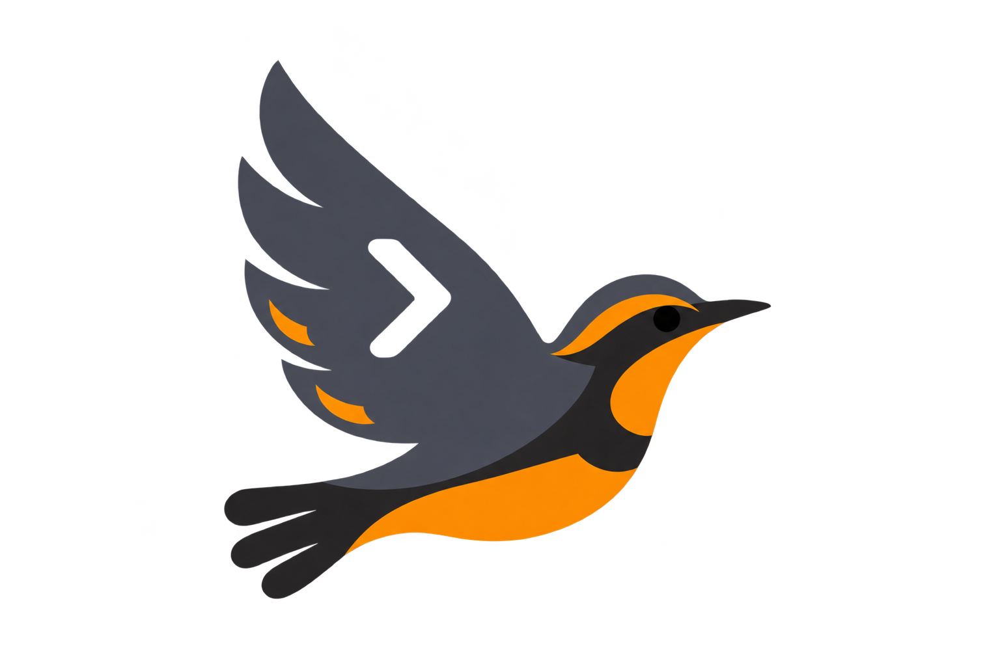
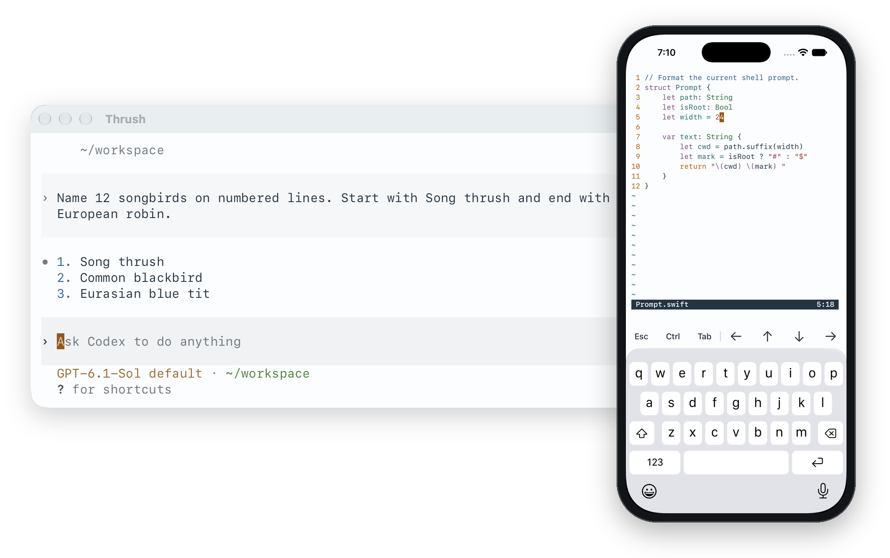

<p align="center"></p>

# Thrush

Thrush is a native terminal for Mac and iPhone apps. A Swift emulator with no dependencies turns PTY output into a screen, one Metal renderer draws it on both platforms, and native text input, selection, the pasteboard and VoiceOver handle everything a person does with it. An app can use the built-in WebSocket transport with any server that speaks Thrush’s protocol. [Toy Box](https://github.com/lostintangent/toy-box) is the first app to use it, bringing its shells to Mac and iPhone.

<picture>
  <source media="(prefers-color-scheme: dark)" srcset="docs/images/thrush-dark.png">
  
</picture>

## Add a terminal to an app

Add the package and link the `Thrush` product to your app target. Thrush needs macOS 27 or iOS 27 and Swift 6.4. It builds from the command line with Xcode 27.2 or, for Mac, Command Line Tools.

```swift
.package(url: "https://github.com/lostintangent/thrush", from: "0.2.0")
```

Keep the tab’s `TerminalSession` in a main-actor model that outlives the view. Each session owns a terminal and talks to one shell. To use the WebSocket transport, capture the tab’s stable client ID in the socket factory and pass the session to the pane.

```swift
import Thrush

let session = TerminalSession { size in
    api.terminalSocket(clientID: tabID, size: size)
}

TerminalPane(session)
```

The pane paints its whole frame, fits its grid to the safe area inside it and reports each new size to the session. Give it `.ignoresSafeArea()` and the terminal's background runs under a navigation bar or Mac toolbar while its first row starts below. It follows the system appearance between Slate Light and Slate Dark, shows the Esc, Ctrl, Tab and arrow key row above the iPhone keyboard, and handles focus, selection, copying and scrolling through history. The WebSocket stays attached while the pane is shown, including in a Mac window behind other apps, minimized or hidden. It detaches when the pane leaves the screen or the iPhone app goes to the background.

On `main`, a small spinner appears at the cursor while the session opens or reconnects. A lost socket retries after 250 ms, backing off to 4 s. Typing waits until replay restores the same shell. If another window takes the shell, the pane keeps its last screen. Tap the terminal or type to take it back. The first keystroke reaches the shell once replay restores its input modes.

An app can choose which tab accepts input and set the appearance. On iPhone, it can also hide the key row of Esc, Ctrl, Tab and arrow keys above the keyboard. Each argument after the session is optional.

```swift
TerminalPane(
    session,
    isActive: isSelectedTab,        // false while a tab stays in the hierarchy but is hidden
    theme: .slateDark,              // nil follows the system appearance
    fontSize: 15,
    showsKeyRow: false              // iPhone only. The row is shown by default
)
```

To customize the colors, edit a copy of `TerminalTheme.slateDark` or `.slateLight` and pass it as `theme:`. A `Terminal.Palette` holds the foreground, background and 16 ANSI colors as `Terminal.RGB` values.

SwiftUI observes `session.title` and `session.hasEnded` directly. On `main`, a shell that exits, is closed by the app, or is replaced during a reconnect leaves its final screen and history readable. Both sample apps keep that screen until the user chooses **New Shell** in the app’s toolbar. The button makes a new `TerminalSession` with the app’s socket factory. [Pane lifecycle](docs/design/pane-states.md)

```swift
TerminalPane(model.tab.session)
    .toolbar {
        if model.tab.session.hasEnded {
            Button("New Shell", action: model.newShell)
        }
    }
```

The tab model’s `newShell()` replaces the finished tab with a new one. To end a session explicitly, call `try await session.close()`. [Complete SwiftUI example](examples/app-consumer/Sources/AppConsumer/AppConsumer.swift)

### WebSocket transport

On every attachment, the socket factory receives the current `Terminal.Size` in columns and rows. Return a fresh, suspended `URLSessionWebSocketTask` for the same client ID each time, created from your app’s `URLSession` so its authentication and TLS settings apply. Connect to `/socket?service=terminal&clientId=…&cols=…&rows=…`. Binary messages carry terminal input and output in order. Small JSON messages handle ready, resize, close and exit. Reattaching with the same ID during the orphan window restores the previous shell. [Terminal protocol](docs/protocol.md)

### Supply a transport

Tag `v0.2.0` provides the socket initializer above. On `main`, an app can also supply a `TerminalTransport` for a local PTY or a remote shell over SSH. In this example, the app provides the SSH client and its sendable `ShellChannel`.

```swift
import Foundation
import Thrush

struct SSHTransport: TerminalTransport {
    let channel: ShellChannel

    func read() async throws -> Data? { try await channel.readOutput() }
    func write(_ bytes: Data) async throws { try await channel.sendInput(bytes) }
    func resize(to size: Terminal.Size) async throws {
        try await channel.setWindowSize(columns: size.columns, rows: size.rows)
    }
    func close() async { await channel.shutdown() }
}

let session = TerminalSession(openTransport: { size in
    let channel = try await ssh.openShell(columns: size.columns, rows: size.rows)
    return SSHTransport(channel: channel)
})

TerminalPane(session)
```

The factory opens a shell at the pane’s measured grid size. A local PTY implements the same four transport methods. Return `nil` from `read()` after the last output bytes. Make `close()` release the transport’s resources and wake pending I/O. While the app can run, the session keeps reading and answering terminal queries with the pane hidden. Showing it again displays the current screen. EOF or a transport error ends the session with its final screen intact. A new session calls the factory to open its own shell. [External app example](examples/app-consumer/Sources/AppConsumer/ShellTab.swift)

## Try the sample apps

From the repository root, start the local server. It prints its loopback URL and opens a real shell when the app connects.

```sh
swift run ThrushServer
```

In a second terminal, build and open the Mac app. The same server works with the iPhone Simulator.

```sh
scripts/build-demo.sh mac && open .build/demo/mac/Thrush.app
```

`scripts/build-demo.sh simulator` builds the iPhone app. Pass `--endpoint URL` to either app to use another server. A scripted peer supplies the recorded demo scenes for offline playback. [Running the sample apps](docs/demo.md)

## Benchmarks

`swift run -c release ThrushBench` checks every recorded replay against an independent reference emulator, then writes its measurements to `.build/benchmarks`.

| Measure | Result | Report |
| --- | --- | --- |
| Sustained output | 445 MiB/s at 80 × 24, against a 100 MiB/s target | [Headless](Benchmarks/headless.md#recorded-mac-measurements) |
| Recorded workflows | Shell 135, resumable Vim 330 and Codex 219 MiB/s, with every checkpoint matching the reference | [Headless](Benchmarks/headless.md#recorded-interaction-measurements) |
| Resize with full history | Worst p95 0.796 ms, against one 120 Hz frame of 8.333 ms | [Headless](Benchmarks/headless.md#recorded-mac-measurements) |
| Warm full-grid redraw | p95 0.274 ms CPU and 0.102 ms GPU in the Mac app | [Rendering](Benchmarks/rendering.md) |
| Idle | Zero frames while idle or hidden | [Rendering](Benchmarks/rendering.md) |
| Reattach | Foreground ready and replay to Up p95 0.872 ms over loopback | [WebSocket lifecycle](Benchmarks/connection.md) |
| Real shells | Bash, Vim, Codex and shell lifecycle on Mac and iPhone, with 34 checkpoints per platform and end-to-end byte counts | [Live workflows](Benchmarks/live-workflows.md) |

The timings come from one contended M1 Max, so they show headroom rather than a timing baseline. [All benchmarks](Benchmarks/README.md) covers each command, what it checks and the real PTY runs.

## Develop

[AGENTS.md](AGENTS.md) lists the build, test and check commands. [The plan](docs/plan.md) is the source of truth for requirements, contracts, budgets and milestones, and [the design docs](docs/design) cover Slate, glass and the pane lifecycle.

## License

Thrush is available under the [MIT License](LICENSE).
