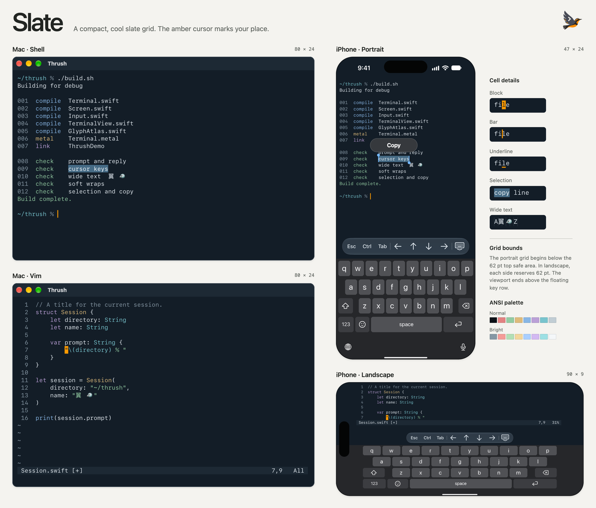
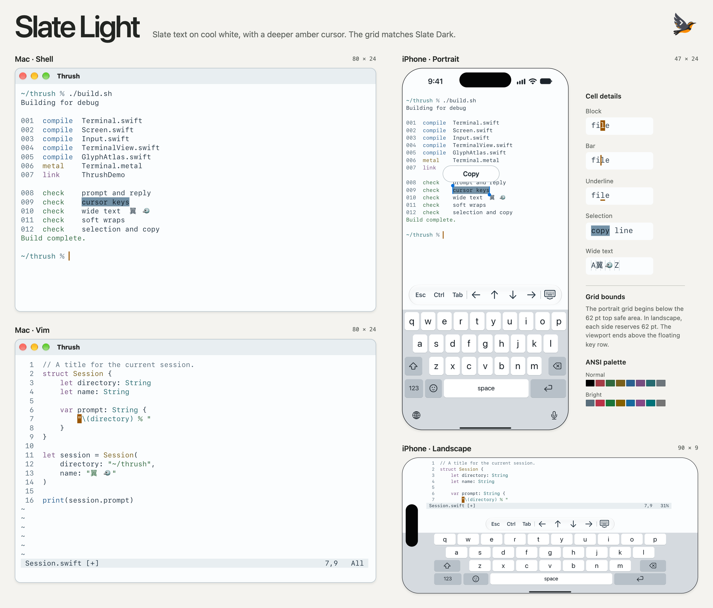

# Thrush on Mac and iPhone

**Thrush draws in Slate on Mac and iPhone.** Slate Dark and Slate Light follow the system appearance by default. They share the same font, grid geometry, native controls and interactions. An app can supply a custom theme.

## Slate Dark

The slate canvas continues to the iPhone safe areas. On Mac, the native title bar carries the window controls. The terminal owns the space below it. The amber from the Thrush mark is reserved for the cursor. Build stages and Vim syntax keep their own ANSI colors. On iPhone, one glass capsule of keys floats above the keyboard with Esc, Ctrl, Tab, the arrows and Hide Keyboard.

| Setting | Value |
| --- | --- |
| Mac type | SF Mono Regular, 14 pt on 18 pt rows |
| iPhone type | SF Mono Regular, 13 pt on 18 pt rows |
| First baseline below row top | 14 pt on Mac, 13 pt on iPhone at the specified sizes |
| Mac grid inset | 12 pt horizontally, 10 pt vertically |
| iPhone grid inset | 10 pt horizontally, 8 pt vertically |
| Default foreground / background | `#E3EAF0` / `#131D27` |
| Cursor / glyph under block | `#FD9A01` / `#131D27` |
| Selected background / text | `#466B85` / `#F8FBFE` |
| Contrast, default / selected text | 14.03 / 5.46 to 1 |
| Opaque backing | `#1D2934` |
| Key row dividers | `#E3EAF0` at 30% opacity, 2.23:1 on the glass and 2.41:1 on the opaque backing |
| iPhone 17 grid, keyboard open | 47 × 24 portrait, 90 × 9 landscape. Derive the live grid from the measured keyboard and safe areas. |

## Slate Light

Slate text sits on a cool white canvas. The amber cursor deepens to ochre so a two-point bar is visible on white. The same 720 × 486 pt Mac window fits 80 × 24 cells in either appearance. Portrait and landscape keep the same 47 × 24 and 90 × 9 grids as Slate Dark.

| Token | sRGB value | Contrast |
| --- | --- | --- |
| Default foreground / background | `#233442` / `#FBFDFE` | 12.54:1 |
| Cursor / glyph under block | `#995500` / `#FFFFFF` | Cursor on canvas 5.63:1, block glyph 5.75:1 |
| Selected background / text | `#7391A6` / `#101C25` | Selected text 5.21:1, highlight against canvas 3.25:1 |
| Opaque backing | `#E8EEF1` | Native title bar, and the key row and Latest under Reduce Transparency |
| Key row dividers | `#233442` at 30% opacity | 1.78:1 on the glass and 1.76:1 on the opaque backing |

The ratios below use WCAG relative luminance for opaque sRGB against `#FBFDFE`. Yellows are ochres. The white slots use a cool gray and a neutral gray so ordinary and bright white text both remain readable. Those two inks also reach 4.53:1 and 4.56:1 on the theme’s ANSI black. [W3C contrast calculation](https://www.w3.org/WAI/WCAG22/Understanding/contrast-minimum.html)

| ANSI color | Normal index | Normal ink | Contrast | Bright index | Bright ink | Contrast |
| --- | ---: | --- | ---: | ---: | --- | ---: |
| Black | 0 | `#000000` | 20.58:1 | 8 | `#586D7B` | 5.29:1 |
| Red | 1 | `#A43D46` | 6.17:1 | 9 | `#BB3147` | 5.65:1 |
| Green | 2 | `#30683E` | 6.48:1 | 10 | `#197539` | 5.65:1 |
| Yellow | 3 | `#79601C` | 5.88:1 | 11 | `#856100` | 5.55:1 |
| Blue | 4 | `#2B608F` | 6.49:1 | 12 | `#16699E` | 5.80:1 |
| Magenta | 5 | `#764D80` | 6.55:1 | 13 | `#864887` | 6.26:1 |
| Cyan | 6 | `#276A70` | 6.09:1 | 14 | `#007278` | 5.60:1 |
| White | 7 | `#6D767C` | 4.54:1 | 15 | `#757575` | 4.52:1 |

### Theme values and appearance changes

Each resolved terminal theme exposes **22 opaque sRGB colors**. `TerminalTheme` carries one `Terminal.Palette` for the 18 core colors and four `Terminal.RGB` values for the cursor and selection. Each RGB component is an 8-bit sRGB value.

| Values | Use |
| --- | --- |
| Default foreground and background | Resolve cells that inherit text or background colors, and answer OSC 10 and 11 queries. |
| 16 ANSI colors in index order | Slots 0–7 supply normal colors and 8–15 supply bright colors. Use each slot for indexed foreground, indexed background and the corresponding OSC 4 reply. |
| Cursor fill and block glyph ink | Use the fill for block, bar and underline cursors. Redraw a monochrome glyph under a block with the block glyph ink. |
| Selection background and foreground | Cover whole selected cells and draw selected text in the foreground ink. Inside a selection, use that ink for the cursor and the selection background for a block’s glyph. This keeps the cursor visible where the two highlights meet. |

The opaque backing serves the key row and Latest under Reduce Transparency and can guide an app’s title bar. The key row’s dividers take the default foreground at 30% opacity, so they keep their contrast on whatever the glass shows. The terminal view uses the same 22-color contract in every app.

### Colors a program sets

A program can replace the default foreground, background, cursor and any of the 256 indexed colors with OSC 4, 10, 11 and 12. Its colors replace the theme's in drawing and in query replies until it restores them, and the theme supplies the rest. The program's background fills the view's whole frame, including the safe areas, the space below the last full row and an IME preview. Text in the IME preview uses the program's foreground. Selection, the key row and Latest stay on the theme, so the view's own controls look the same under any program.

A block cursor redraws its glyph in the theme's block ink. Once a program sets the cursor color, the glyph takes whichever of the effective foreground and background contrasts more with that cursor.

When an inline navigation bar overlaps the terminal view, the view sets the bar's color scheme to match the canvas below it, so its title stays readable over either background. A bar over the app's own background keeps the app's scheme. The status bar belongs to the app. Under a navigation bar it follows the bar's scheme when the app leaves its style to SwiftUI. The sample apps draw the view beneath the status bar and set its style from the canvas. A full-size Mac window toolbar over the view takes the canvas's appearance the same way, so the program's canvas runs beneath its title, window buttons and items. Beside a split view's sidebar, the sidebar's toolbar items keep the window's appearance. Where AppKit keeps the title over the canvas on the window's appearance, as a SwiftUI window's split view does under its default toolbar background, or carries the canvas's appearance onto the sidebar's items, the toolbar keeps the window's appearance and the canvas stops beneath it. The strip under the bar then takes the theme's background, or the window's when the theme matches the canvas.

On a system appearance change or a user theme edit, apply one resolved palette to the terminal’s query state and to the view. Present the new colors together on the next frame. Keep the viewport, selection, cursor, composition, layout and glyph atlas in place. Previously received rows resolve their default and indexed colors under the new palette. Explicit RGB values retain the program’s chosen colors, and color emoji retain their own pixels. A settled, nonblinking prompt needs one presentation for the change, zero parser work, zero new glyph uploads and zero subsequent idle frames.

## Ember, a custom theme

An app can replace the palette and keep Slate's type and grid. The sample apps show this with `--theme custom`, which uses Ember, a warm palette. Default text reaches 13.80:1 and selected text 5.22:1. Its ANSI colors are in the next table.

| Token | sRGB value |
| --- | --- |
| Default foreground / background | `#EEE4D6` / `#1C1A18` |
| Cursor / glyph under block | `#F0D9B4` / `#1C1A18` |
| Selected background / text | `#78634E` / `#FFF4E1` |

## Slate Dark and Ember ANSI colors

| ANSI color | SGR normal / bright | Slate normal | Slate bright | Ember normal | Ember bright |
| --- | --- | --- | --- | --- | --- |
| Black | 30 / 90 | `#0B1016` | `#8697A4` | `#12110F` | `#978C80` |
| Red | 31 / 91 | `#E28282` | `#F49C98` | `#DE8676` | `#F0A493` |
| Green | 32 / 92 | `#93CBA2` | `#B2DFB5` | `#A6BD89` | `#BFDAA1` |
| Yellow | 33 / 93 | `#DEBB7B` | `#F2D69C` | `#DDB278` | `#F4CF93` |
| Blue | 34 / 94 | `#88B6E5` | `#A9CFFF` | `#98ABD0` | `#B5C9E8` |
| Magenta | 35 / 95 | `#BBA0D7` | `#D3B9F2` | `#C99DAF` | `#E3B9C9` |
| Cyan | 36 / 96 | `#78C4CE` | `#9CE0E4` | `#88B9B0` | `#A6D4CB` |
| White | 37 / 97 | `#C1CDD4` | `#F4F7F9` | `#CFC2AD` | `#F8EEDD` |

Use the same colors for the corresponding SGR background indexes. ANSI black is available to programs for deliberate black text or fills. Shell output often uses bright black for secondary text. Slate keeps index 8 readable in that role at 5.66:1 in Dark and 5.29:1 in Light. The 80-column, 256-color Codex recording also puts the default foreground on an index-8 background. Its prompt band reaches only 2.48:1 and 2.37:1 respectively. With these foregrounds and canvases, the best equal contrast for those two uses is 3.75:1 in Dark and 3.54:1 in Light. Keep one faithful color per ANSI slot. For the production Codex workflow, check the actual truecolor background received from the PTY against the displayed ink.

Underlines take SF Mono's own position and thickness, rounded up to whole pixels: 2 pixels on a 2× Mac and a 3× iPhone, and 1 on a 1× display. A double underline is two lines half as thick that bound a band below the underline's top, and a curly one waves once per cell across that same band, so both stay inside their row. Dotted underlines are square dots, each one stroke wide and a stroke apart on whole pixels, so every gap matches even where a cell's advance isn't whole pixels. Dashed ones clear the middle third of every column, so each dash bridges two cells rather than sitting under one like an underscore. Each runs on unbroken from cell to cell. SGR 58 colors the underline. Without it, and under selection or a block cursor, the underline takes the text's ink. Strikethrough crosses the middle of the x-height. An overline clears the ascenders by the gap the underline leaves below the baseline, so it reads with its own row rather than as an underline of the row above.

Use a 0.70 blend of foreground over background for SGR 2 dim text. In the real-PTY Codex composer, the dim placeholder measures 4.72:1 in Slate Light (`#616D77` on `#F0F2F3`) and 5.73:1 in Slate Dark (`#ACB5BB` on `#2F3840`). Dim applies to the glyph and to its underline, overline and strikethrough.

SGR 5 blinking text fades its glyph, underline, overline and strikethrough out and back in on a 1.2 s cycle: shown for 0.5 s, a 0.2 s ease out, hidden for 0.3 s and a 0.2 s ease in. That is 50 blinks a minute, slower than the 150 ECMA-48 allows for slow blink. Backgrounds, inverse paper, selection and the cursor hold still, and a block cursor keeps its glyph. Every terminal view follows one clock, so all blinking text fades together. With Reduce Motion, blinking text stays shown.

SGR 8 concealed text keeps its cells, background, selection and cursor and draws no glyph, underline, overline or strikethrough. VoiceOver reads it as blank, as a sighted reader sees it. Copy keeps its characters, so selecting and copying reveals it as in other terminals, with or without VoiceOver.

## Native surfaces and motion

The Mac images show active AppKit title bars on macOS 27.2.1. The iPhone images show the English software keyboard with predictions off. In the packaged iPhone 17 simulator app, the keyboard covers 301 pt of the 402 × 874 pt portrait window. The key row's 48 pt capsule floats 12 pt above it, from y = 513 to 561 pt, leaving room for 47 × 24 cells. In landscape the keyboard covers 180 pt of the 874 × 402 pt window. The capsule slims to 36 pt and floats 8 pt above it, from y = 178 to 214 pt, leaving room for 90 × 9 cells. Size the grid from the actual keyboard guide on each device. [Key row captures](keyboard-capsule.png)

Shell output and Vim content in the images are examples. When an app embeds the view, it supplies the surrounding window and navigation controls. Use system materials for the title bar, key row and edit menu. Respect Reduce Transparency with the opaque backing. The Metal grid uses solid cell colors. [Glass in Thrush](glass.md) specifies the key row and Latest materials and shows why the grid stays opaque.

| Moment | Behavior |
| --- | --- |
| Type and move the cursor | Apply the shell’s echoed character and cursor from the same displayed generation. A block occupies the cell and redraws its glyph in the block ink. A bar sits on the leading edge. An underline sits at the cell bottom. The latter two are 2 pt thick. Position and shape change on the next requested frame, without interpolation. The images show a steady cursor. |
| Select and copy | On Mac, drag for a character range or double-click for a word. On iPhone, long-press to select a word. Cell edges define the highlight. Native iOS handles expand or contract the range and the system edit menu anchors to it on release. Use the native selection tint for handles and the specified colors for selected cells. Copy omits soft-wrap breaks and retains hard line breaks. The accessibility selection uses the same logical range. |
| Read earlier output | Use native scrolling and deceleration in normal-screen history. Preserve the visible logical line when fresh bytes arrive. Show the system scroll indicator and a **Latest** button with a 44 pt minimum hit target while away from the live edge. Return to the bottom on activation. Hide the control at the live edge and while the alternate screen owns input. |
| Open the keyboard | Tapping the terminal brings up the keyboard with the key row floating above it. Esc, Ctrl, Tab, the four arrows and Hide Keyboard each receive at least a 44 × 44 pt hit target. A tap on Ctrl arms the next key. Fill the key in the selection colors and expose its selected state to VoiceOver. Tap again to cancel. Clear the latch after use, focus loss or detachment. Typing, character composition, paste and a hardware keyboard share the same viewport. |
| Move with the keyboard | The terminal, key row and keyboard move together on the keyboard’s own curve, whether it rises, hides, turns with the device or changes height for predictions, emoji or a hardware keyboard. A prompt on the bottom row rides the key row’s top edge the whole way, and a prompt higher up stays where it is. While the terminal waits for its new grid, rows above the grid come from history, so no frame shows a blank band. At a shell prompt the settled grid replaces the moving frame without a visible change, and a full-screen program redraws once. With Reduce Motion, update geometry directly. |
| Put the keyboard away | Hide Keyboard on the key row ends input and clears the latch. Swiping through history scrolls it and leaves the keyboard up. |
| Rotate | Let the system transition coordinator move the view and its controls. Keep the visible logical row or live prompt anchored as the keyboard turns. Send the shell one whole-cell grid when the keyboard and view reach their destination. Preserve glyph proportions throughout the turn, including while the previous drawable is visible. Draw the new grid at the destination scale. With Reduce Motion, update geometry directly. |
| Settle | Stop requesting Metal frames when the last change is presented. System menu, key-press and key row animations belong to the native views. A settled or backgrounded terminal requests zero further frames. Visible blinking text requests frames only during its fades, at up to 60 Hz, and none while it is fully shown or hidden, while the view is hidden or suspended, or with Reduce Motion. Keep the first-echo presentation time independent of the app's transitions. |

## Rendering

- Use the system monospaced face. Ask Core Text for the digit advance at the chosen size. Snap boundaries from cumulative advances to backing pixels. Keep incomplete columns and rows in the trailing and bottom inset. The listed sizes are defaults. Recompute advances, baselines and grid size when the user changes text size or moves to a display with a different scale.
- Shape **A翼🐦Z** into six terminal columns. The ideograph spans two cells and the Unicode 11 bird emoji spans two. Core Text supplies the CJK fallback and Apple Color Emoji glyph. Keep the emoji’s intrinsic color and extend a selection through both halves of a wide character.
- The Mac images use a 720 × 486 pt window with a 32 pt system title bar, which fits 80 × 24 cells. The portrait image uses 402 × 874 pt with a 62 pt top safe area. With the keyboard open, it begins at y = 573 pt and the key row’s capsule runs from y = 513 to 561 pt. The landscape image uses 874 × 402 pt with 62 pt left and 62 pt right safe areas. Its keyboard begins at y = 222 pt and the capsule runs from y = 178 to 214 pt. At runtime, measure the top edge of the combined obstruction from the keyboard layout guide and key row geometry. Deduct the key row height once. With a hardware keyboard, use the lower safe area and the controls actually on screen.
- Keep marked text local to the input view, anchor it at the cursor, and send only the single committed string. Expose accessible terminal lines, selections, modifier state and the return-to-latest action through each platform's accessibility API.

Sign-off compares the palette, cell boundaries, cursor ink and baseline placement against captures of the running Mac and iPhone views. Keyboard timing, VoiceOver, physical-device legibility and idle-frame counts are checked in the running apps.
