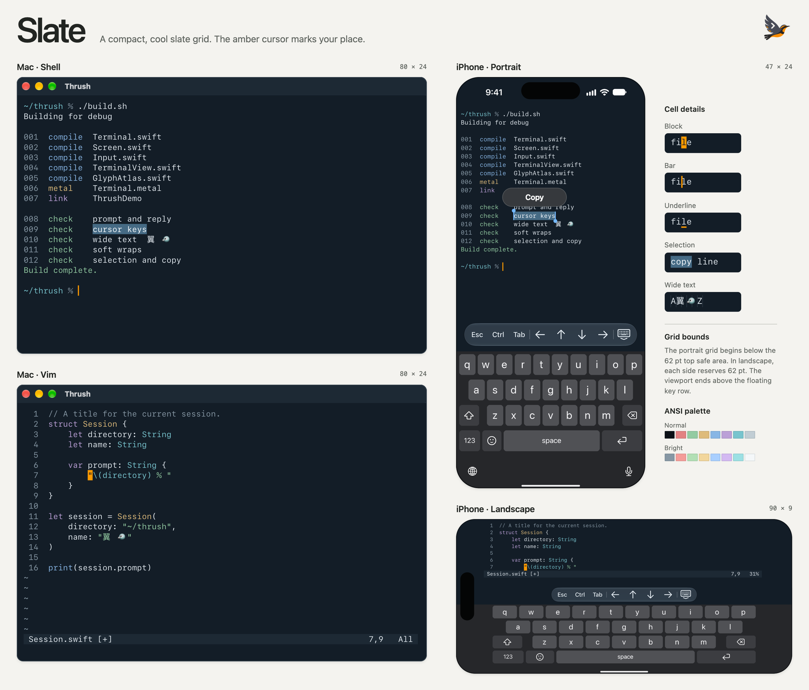
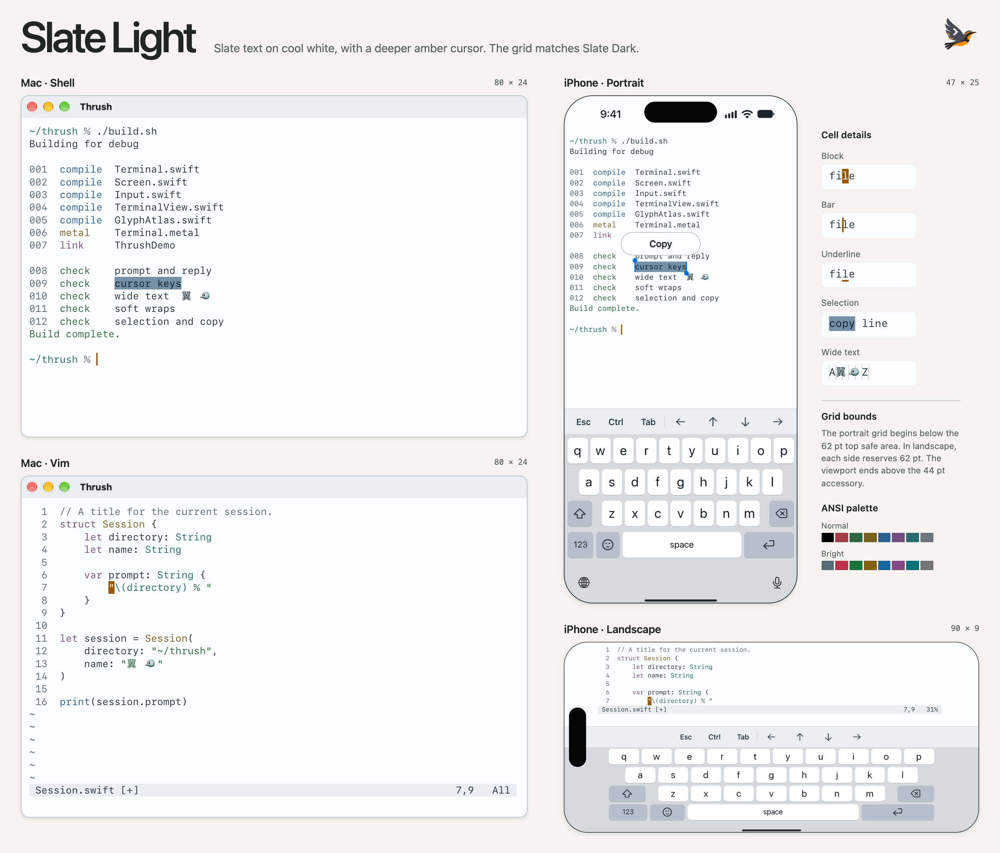
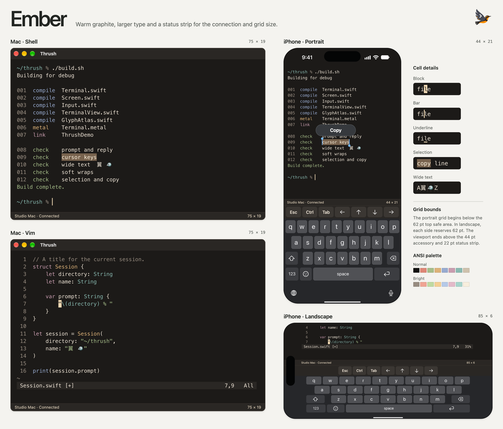

# Thrush on Mac and iPhone

**Slate is the approved design for the Mac and iPhone hosts.** Slate Dark and Slate Light follow the system appearance by default. They share the same font, grid geometry, native controls and interactions. A host can supply a custom theme.

## Slate Dark

The slate canvas continues to the iPhone safe areas. On Mac, the native title bar carries the window controls. The terminal owns the space below it. The amber from the Thrush mark is reserved for the cursor. Build stages and Vim syntax keep their own ANSI colors. The iPhone accessory uses plain native buttons on one keyboard-style input view, with a separator before the arrows.

| Setting | Value |
| --- | --- |
| Mac type | SF Mono Regular, 14 pt on 18 pt rows |
| iPhone type | SF Mono Regular, 13 pt on 18 pt rows |
| First baseline below row top | 14 pt on Mac, 13 pt on iPhone at the specified sizes |
| Mac grid inset | 12 pt horizontally, 10 pt vertically |
| iPhone grid inset | 10 pt horizontally, 8 pt vertically |
| Default foreground / background | `#E3EAF0` / `#131D27` |
| Cursor / glyph under block | `#FD9A01` / `#131D27` |
| Selected background / text | `#466B85` / `#F8FBFE` |
| Contrast, default / selected text | 14.03 / 5.46 to 1 |
| Host backing / separator | `#1D2934` / `#35424E` |
| iPhone 17 study grid, keyboard open | 47 × 25 portrait, 90 × 9 landscape. Derive the live grid from the measured keyboard and safe areas. |

## Slate Light

Slate text sits on a cool white canvas. The amber cursor deepens to ochre so a two-point bar is visible on white. The same 720 × 486 pt Mac window fits 80 × 24 cells in either appearance. The portrait and landscape studies keep the same 47 × 25 and 90 × 9 grids as Slate Dark.

| Token | sRGB value | Contrast |
| --- | --- | --- |
| Default foreground / background | `#233442` / `#FBFDFE` | 12.54:1 |
| Cursor / glyph under block | `#995500` / `#FFFFFF` | Cursor on canvas 5.63:1, block glyph 5.75:1 |
| Selected background / text | `#7391A6` / `#101C25` | Selected text 5.21:1, highlight against canvas 3.25:1 |
| Host backing / separator | `#E8EEF1` / `#B7C3CA` | Native title bar and accessory backing |

The ratios below use WCAG relative luminance for opaque sRGB against `#FBFDFE`. Yellows are ochres. The white slots use a cool gray and a neutral gray so ordinary and bright white text both remain readable. Those two inks also reach 4.53:1 and 4.56:1 on the theme’s ANSI black. [W3C contrast calculation](https://www.w3.org/WAI/WCAG22/Understanding/contrast-minimum.html)

| ANSI color | Normal index | Normal ink | Contrast | Bright index | Bright ink | Contrast |
| --- | ---: | --- | ---: | ---: | --- | ---: |
| Black | 0 | `#000000` | 20.58:1 | 8 | `#586D7B` | 5.29:1 |
| Red | 1 | `#A43D46` | 6.17:1 | 9 | `#BB3147` | 5.65:1 |
| Green | 2 | `#30683E` | 6.48:1 | 10 | `#197539` | 5.65:1 |
| Yellow | 3 | `#79601C` | 5.88:1 | 11 | `#856100` | 5.55:1 |
| Blue | 4 | `#2B608F` | 6.49:1 | 12 | `#16699E` | 5.80:1 |
| Magenta | 5 | `#764D80` | 6.55:1 | 13 | `#864887` | 6.26:1 |
| Cyan | 6 | `#276A70` | 6.09:1 | 14 | `#007278` | 5.60:1 |
| White | 7 | `#6D767C` | 4.54:1 | 15 | `#757575` | 4.52:1 |

### Theme values and appearance changes

Each resolved terminal theme exposes **22 opaque sRGB colors**. `TerminalTheme` carries one `Terminal.Palette` for the 18 core colors and four `Terminal.RGB` values for the cursor and selection. Each RGB component is an 8-bit sRGB value.

| Values | Use |
| --- | --- |
| Default foreground and background | Resolve cells that inherit text or background colors. Use these in OSC 10 and 11 replies. |
| 16 ANSI colors in index order | Slots 0–7 supply normal colors and 8–15 supply bright colors. Use each slot for indexed foreground, indexed background and the corresponding OSC 4 reply. |
| Cursor fill and block glyph ink | Use the fill for block, bar and underline cursors. Redraw a monochrome glyph under a block with the block glyph ink. |
| Selection background and foreground | Cover whole selected cells and draw selected text in the foreground ink. Inside a selection, use that ink for the cursor and the selection background for a block’s glyph. This keeps the cursor visible where the two highlights meet. |

The host supplies its title-bar and accessory materials. The backing and separator swatches guide those surfaces. TerminalView uses the same 22-color contract when embedded in a different host.

On a system appearance change or a user theme edit, apply one resolved palette to the terminal’s query state and to the view. Present the new colors together on the next frame. Keep the viewport, selection, cursor, composition, layout and glyph atlas in place. Previously received rows resolve their default and indexed colors under the new palette. Explicit RGB values retain the program’s chosen colors, and color emoji retain their own pixels. A settled, nonblinking prompt needs one presentation for the change, zero parser work, zero new glyph uploads and zero subsequent idle frames.

## Ember design study

The warmer canvas, Menlo’s larger letterforms and extra leading leave more room around each glyph. A thin host strip names the connected peer and shows the grid dimensions. It sits below Vim’s own status and command lines, so it remains distinct when an editor takes the alternate screen. The accessory uses individually tinted native keycaps and system press feedback.

| Setting | Value |
| --- | --- |
| Mac type | Menlo Regular, 15 pt on 21 pt rows |
| iPhone type | Menlo Regular, 14 pt on 20 pt rows |
| First baseline below row top | 16 pt on Mac, 15 pt on iPhone at the specified sizes |
| Mac grid inset | 18 pt horizontally, 14 pt vertically |
| iPhone grid inset | 14 pt horizontally, 10 pt vertically |
| Default foreground / background | `#EEE4D6` / `#1C1A18` |
| Cursor / glyph under block | `#F0D9B4` / `#1C1A18` |
| Selected background / text | `#78634E` / `#FFF4E1` |
| Contrast, default / selected text | 13.80 / 5.22 to 1 |
| Host backing / separator | `#2A2724` / `#48413B` |
| Host status strip | 22 pt at the foot of the viewport, above the keyboard accessory on iPhone. Show the active peer and whole-cell dimensions. |
| iPhone 17 grid, keyboard open | 44 × 21 portrait, 85 × 6 landscape |

## Slate Dark and Ember ANSI colors

| ANSI color | SGR normal / bright | Slate normal | Slate bright | Ember normal | Ember bright |
| --- | --- | --- | --- | --- | --- |
| Black | 30 / 90 | `#0B1016` | `#8697A4` | `#12110F` | `#978C80` |
| Red | 31 / 91 | `#E28282` | `#F49C98` | `#DE8676` | `#F0A493` |
| Green | 32 / 92 | `#93CBA2` | `#B2DFB5` | `#A6BD89` | `#BFDAA1` |
| Yellow | 33 / 93 | `#DEBB7B` | `#F2D69C` | `#DDB278` | `#F4CF93` |
| Blue | 34 / 94 | `#88B6E5` | `#A9CFFF` | `#98ABD0` | `#B5C9E8` |
| Magenta | 35 / 95 | `#BBA0D7` | `#D3B9F2` | `#C99DAF` | `#E3B9C9` |
| Cyan | 36 / 96 | `#78C4CE` | `#9CE0E4` | `#88B9B0` | `#A6D4CB` |
| White | 37 / 97 | `#C1CDD4` | `#F4F7F9` | `#CFC2AD` | `#F8EEDD` |

Use the same colors for the corresponding SGR background indexes. ANSI black is available to programs for deliberate black text or fills. The transcript uses bright black for secondary text.

## Native surfaces and motion

The Mac studies use active AppKit title bars captured on macOS 27.2.1. The iPhone keyboards and edit menus are layout studies of the English software keyboard with predictions off. The status glyphs and SF Symbols come from the system. The simulator reported a 402 × 874 pt scene. Keyboard heights and safe-area insets below are design inputs awaiting measurement in the running host. [Apple’s iPhone keyboard guide](https://support.apple.com/guide/iphone/type-with-the-onscreen-keyboard-iph3c50f96e/27/ios/27)

Shell output, Vim content and compositing are design examples. When Toy Box embeds the view, it supplies the surrounding window and navigation controls. Use system materials for the title bar, keyboard accessory and edit menu. Respect Reduce Transparency with an opaque host backing. The Metal grid uses solid cell colors.

| Moment | Behavior |
| --- | --- |
| Type and move the cursor | Apply the shell’s echoed character and cursor from the same displayed generation. A block occupies the cell and redraws its glyph in the block ink. A bar sits on the leading edge. An underline sits at the cell bottom. The latter two are 2 pt thick. Position and shape change on the next requested frame, without interpolation. The studies use a steady cursor. |
| Select and copy | On Mac, drag for a character range or double-click for a word. On iPhone, long-press to select a word. Cell edges define the highlight. Native iOS handles expand or contract the range and the system edit menu anchors to it on release. Use the native selection tint for handles and the specified colors for selected cells. Copy omits soft-wrap breaks and retains hard line breaks. The accessibility selection uses the same logical range. |
| Read earlier output | Use native scrolling and deceleration in normal-screen history. Preserve the visible logical line when fresh bytes arrive. Show the system scroll indicator and a **Latest** button with a 44 pt minimum hit target while away from the live edge. Return to the bottom on activation. Hide the control at the live edge and while the alternate screen owns input. |
| Open the keyboard | The native accessory shares the keyboard’s frame transition and system timing curve. Esc, Ctrl, Tab and four arrow buttons each receive at least a 44 × 44 pt hit target. A tap on Ctrl arms the next key. Show a filled accent capsule with a contrasting “Ctrl” label and expose its selected state to VoiceOver. Tap again to cancel. Clear the latch after use, focus loss or detachment. Typing, character composition, paste and a hardware keyboard share the same viewport. |
| Rotate or dismiss the keyboard | Let the system transition coordinator move the host and controls. Compute whole cells from the new usable bounds, apply each distinct size once and anchor the visible logical row or live prompt. Draw glyphs at the destination scale. With Reduce Motion, update geometry directly. |
| Settle | Stop requesting Metal frames when the last change is presented. System menu, key-press and accessory animations belong to the native views. With blink disabled, a settled or backgrounded terminal requests zero further frames. Keep the first-echo presentation time independent of host transitions. |

## Renderer handoff

- Use the system monospaced face for Slate and Menlo Regular for Ember. Ask Core Text for the digit advance at the chosen size. Snap boundaries from cumulative advances to backing pixels. Keep incomplete columns and rows in the trailing and bottom inset. The listed sizes are defaults. Recompute advances, baselines and grid size when the user changes text size or moves to a display with a different scale.
- Shape **A翼🐦Z** into six terminal columns. The ideograph spans two cells and the Unicode 11 bird emoji spans two. Core Text supplies the CJK fallback and Apple Color Emoji glyph. Keep the emoji’s intrinsic color and extend a selection through both halves of a wide character.
- Both Mac studies use the same 720 × 486 pt window and 32 pt system title bar. Slate fits 80 × 24 cells. Ember fits 75 × 19 after its wider insets, larger type and status strip. The portrait study uses 402 × 874 pt with a 62 pt top safe area. With the keyboard open, its top is at y = 583 pt. The landscape study uses 874 × 402 pt with 62 pt left and 62 pt right safe areas. Its keyboard begins at y = 222 pt. The 44 pt accessory ends at that keyboard edge. At runtime, measure the top edge of the combined obstruction from the keyboard layout guide and accessory geometry. Deduct the accessory height once. With a hardware keyboard, use the lower safe area and the controls actually on screen.
- Keep marked text local to the input view, anchor it at the cursor, and send only the single committed string. Expose accessible terminal lines, selections, modifier state and the return-to-latest action through the native host.

The first Metal review compares the selected palette, cell boundaries, cursor ink and baseline placement in actual Mac and iPhone captures. Keyboard timing, VoiceOver, physical-device legibility and idle-frame counts need verification in the running hosts.
