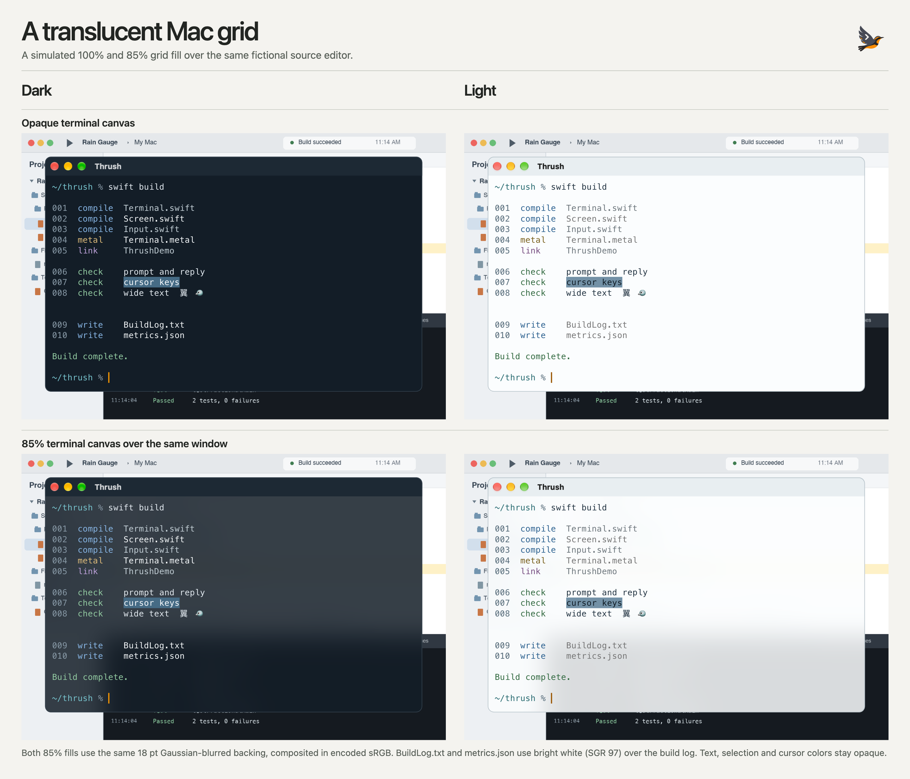

# Glass in Thrush

Use regular system glass for **Latest** when someone is reading history. On iPhone, try one shared glass surface for the seven accessory keys. Keep the native Mac title bar and the opaque Slate grid. Even at 92% opacity, a window behind the grid can make light-theme file names or the edge of a dark-theme selection hard to see.

## Controls

| Surface | Treatment |
| --- | --- |
| **Latest** | Place a down arrow and **Latest** together in one regular native glass button at the lower trailing edge of history. On Mac, use a 104 × 36 pt visible capsule within a minimum 44 pt hit area. Leave 16 pt between the visible bezel and each of the bottom and trailing edges. Use the primary label and check the arrow and text against the fill in key and inactive windows. Both should reach 4.5:1 while the action is available. Use the opaque Slate treatment below if the native material dims them. Keep clear of selection handles and the edit menu. Activating it returns to the live prompt. Hide it at the live edge and in the alternate screen. |
| **iPhone accessory** | Give the 44 pt accessory one regular native material and seven plain buttons. Keep a subtle divider between Tab and the arrows. The accessory moves with the keyboard. The last terminal row ends above its top edge. Use the keyboard’s own backing if its input view already supplies the material. |
| **Armed Ctrl** | Tap once to show a filled accent, a checkmark and the Ctrl label in the same key. Keep neighboring keys fixed. VoiceOver identifies “Control” and its selected state. Tap again to cancel. Consuming a key, losing focus or detaching clears the latch. The white label and checkmark in the sketches have 6.98:1 contrast in Dark and 7.43:1 in Light. |
| **Mac title bar** | Keep the native title, traffic lights and 32 pt title-bar allocation. At the live edge the first row sits below the bar. A within-window title-bar material can sample departing history as it scrolls past the top edge. Try that only if the first fully visible row remains readable, selection still tracks the pointer and returning to the prompt restores precisely the same grid. |

The difference is most useful on **Latest**. Color from the history can pass through a small transient control, and the arrow still tells you where it leads. The accessory has less to gain from translucency because its backing is usually even. Its value comes from presenting Esc, Ctrl, Tab and the arrows as one row of related actions. Apple's regular material adapts when foreground labels sit over changing content. [Apple’s material guidance](https://developer.apple.com/design/human-interface-guidelines/materials)

**Reduce Transparency.** Use an opaque host backing of `#1D2934` in Dark and `#E8EEF1` in Light. Pair those with `#E3EAF0` and `#233442` labels respectively, for 12.19:1 and 10.92:1 contrast. The opaque Latest outline uses `#8697A4` in Dark or `#586D7B` in Light. When the material changes in place, preserve the hit area, label, checkmark and scroll position. The native title bar should respect the system setting. For a custom history underlay, replace its material with the same opaque backing.

**What the captures establish.** An AppKit test window used a real glass-bezel `NSButton` and a within-window `NSVisualEffectView` with the title-bar material. Reversing a coral and cyan patch under the fixed button changed the same interior pixel from `#D56A54` to `#30A9AB` in Dark and `#FFAB98` to `#7EDEE1` in Light. The sharp split outside the button blends inside its bezel. The Latest and history crops show a compositor capture of an inactive window. The title bar at rest uses an AppKit view capture with an emphasized appearance. The iPhone accessories and opaque fallbacks are proposed layouts. Active-window legibility, live title-bar sampling and the system accessibility transitions need review in the running hosts.

## Terminal background

The same fictional editor sits behind each window. Its white source pane and dark build log remain recognizable as broad regions after an 18 pt Gaussian blur. Only the inherited terminal background changes opacity. Text, explicit cell backgrounds, selection and cursor keep their assigned colors. [Full-resolution backing window](glass-backdrop.png)

| Lowest contrast over that window | Opaque | 92% fill | 85% fill |
| --- | ---: | ---: | ---: |
| Dark default text | 14.03 | 11.19 | 8.83 |
| Dark secondary text, SGR 90 | 5.66 | 4.51 | **3.56** |
| Dark selection edge | 3.00 | **2.39** | **1.89** |
| Light default text | 12.54 | 10.70 | 9.20 |
| Light secondary text, SGR 90 | 5.29 | 4.52 | **3.88** |
| Light bright yellow, SGR 93 | 5.55 | 4.74 | **4.07** |
| Light bright white, SGR 97 | 4.52 | **3.85** | **3.31** |
| Light selection edge | 3.25 | **2.77** | **2.39** |

These ratios express contrast to one. We checked the default foreground, all 16 ANSI inks, cursor and selection at every pixel of the 1440 × 972 backdrop. The table uses source-over blending of 8-bit sRGB components after the blur. We compared unrounded results to 4.5 for regular text and 3 for an identifying boundary. Opaque Dark’s selection edge is 3.003. Its ANSI black is intentionally near the canvas at 1.12. The transcript uses SGR 90 for secondary text. [W3C text contrast](https://www.w3.org/WAI/WCAG22/Understanding/contrast-minimum.html) · [W3C non-text contrast](https://www.w3.org/WAI/WCAG22/Understanding/non-text-contrast.html)

Ordinary text stays readable in both simulated windows at 92% fill. The selection boundary gives way sooner. The glyphs within selected cells still reach 5.46:1 in Dark and 5.21:1 in Light. Repeating the calculation with linear-light blending gives a Dark secondary ink of 2.48:1 and a Light bright white of 4.18:1 at 92%. A blur or a single opacity setting offers little protection against a large bright or dark window moving behind the terminal.

Keep the inherited background opaque in both Slate defaults. A future Mac host could explore a translucent custom theme with a palette tuned for its permitted backdrop range. An actual window test would need to cover Vim’s reverse-video status, selected spaces, foreground and background colors issued by the program, and moving windows underneath. Reduce Transparency returns the grid to a fully opaque fill.

## Running-host review

Check the controls over dense history and colored program output in both appearances. With Reduce Transparency on, arm Ctrl, confirm VoiceOver announces its selected state, then use the next chord. Switching away from the app clears the latch. Verify that Latest still has a readable arrow and label, returns to the same live prompt and leaves the cursor unobstructed. Check keyboard presentation in portrait and landscape for extra insets or clipped hit areas. Repeat with the terminal settled and cursor blink disabled. Count Metal submissions separately from the compositor and energy cost of active glass effects. The physical iPhone and active Mac checks belong with the interaction recordings.
