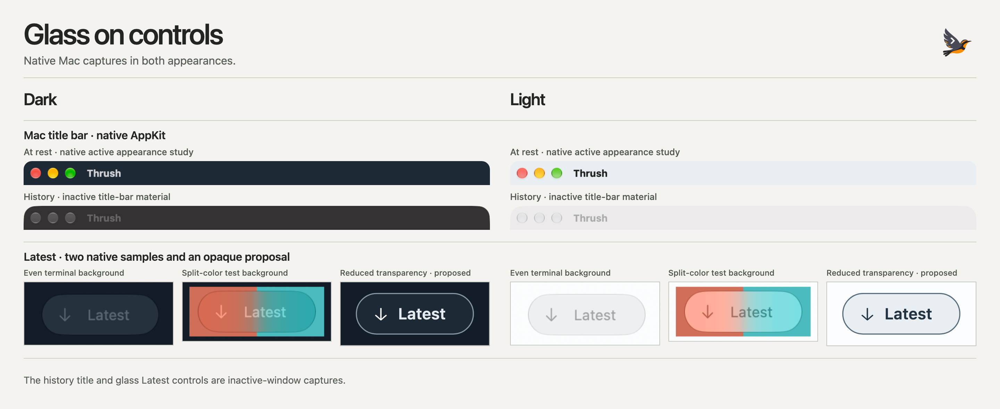
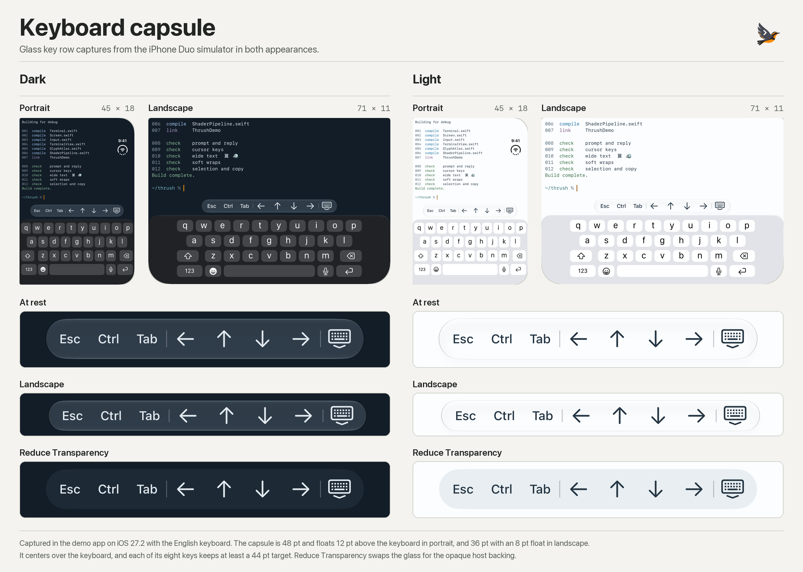
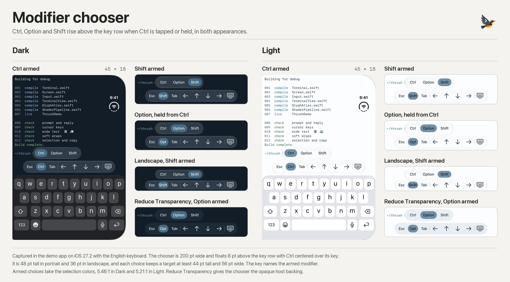

# Glass in Thrush

**Latest** uses regular system glass while someone reads history. On iPhone, the key row is one glass capsule floating above the keyboard. The Mac title bar stays native and the grid stays opaque, because even at 92% opacity a window behind the grid can make light-theme file names or the edge of a dark-theme selection hard to see.

## Controls

| Surface | Treatment |
| --- | --- |
| **Latest** | Place a down arrow and **Latest** together in one regular native glass button at the lower trailing edge of history. On Mac, use a 104 × 36 pt visible capsule within a minimum 44 pt hit area. Leave 16 pt between the visible bezel and each of the bottom and trailing edges. Use the primary label and check the arrow and text against the fill in key and inactive windows. Both should reach 4.5:1 while the action is available. Use the opaque treatment below if the native material dims them. Keep clear of selection handles and the edit menu. Activating it returns to the live prompt. Hide it at the live edge and in the alternate screen. |
| **iPhone key row** | Float one capsule of regular interactive glass above the keyboard, 48 pt tall and 12 pt above it in portrait. In landscape, where every row counts, it slims to 36 pt and floats 8 pt above the keyboard. Center it over the keyboard 16 pt from each side, up to 380 pt wide. The keyboard spans the window even where the iPhone Duo's status bar and camera inset one side of the safe area, so the capsule follows the keyboard. It holds eight plain keys, Esc, Ctrl, Tab, the four arrows and Hide Keyboard, and each gets at least a 44 × 44 pt target. In landscape each key's target reaches down into the float. On a narrow screen the side margins give way before any key does. Dividers in the key ink at 30% opacity set the arrows apart from the keys on either side. The capsule moves with the keyboard, and the last terminal row ends above its top edge. |
| **Armed modifier** | Tap Ctrl once to arm Control for the next key. The key fills with the selection background and draws its label in the selection ink, as Notes and Mail show a toggled format key, and a chooser of Ctrl, Option and Shift rises above the row so a person can find Shift-Return, which adds a line in Claude Code and Codex. Tap a choice to arm it instead, or hold Ctrl, slide to a choice and lift. One modifier is armed at a time, and the key names it as Ctrl, Opt or Shift. Tap the key or the armed choice to cancel. Consuming a key, hiding the keyboard, losing focus, detaching or the terminal no longer taking input clears the latch and lowers the chooser. Fills stay within each key's own width, so neighboring keys stay fixed. Labels on the fill have 5.46:1 contrast in Dark and 5.21:1 in Light. VoiceOver identifies the armed modifier and its selected state, offers Control, Option and Shift as actions on the key, and announces what the next key will carry. |
| **Modifier chooser** | A second capsule of regular interactive glass floats 8 pt above the key row with Ctrl, Option and Shift in that order, Ctrl centered over its key. It is 200 pt wide and 48 pt tall in portrait, or 36 pt in landscape, and each choice takes a target at least 44 pt tall and 56 pt wide. The armed choice, or the one under a sliding finger, takes the selection fill. It rises out of the key on a short spring and fades when lowered. Reduce Motion cross-fades it in place, and Reduce Transparency gives it the opaque backing. The chooser may cover the two rows above the key row while a modifier is armed. |
| **Mac title bar** | Keep the native title, traffic lights and 32 pt title-bar allocation. At the live edge the first row sits below the bar. |

The difference is most useful on **Latest**. Color from the history can pass through a small transient control, and the arrow still tells you where it leads. The key row floats between the last rows and the keyboard, so glass lets it sit lightly over either. Its value comes from presenting the keys as one row of related actions. Apple's regular material adapts when foreground labels sit over changing content. [Apple’s material guidance](https://developer.apple.com/design/human-interface-guidelines/materials)

**Reduce Transparency.** Fill the key row’s capsule and the Latest button with the opaque backing, `#1D2934` in Dark and `#E8EEF1` in Light. Pair those with `#E3EAF0` and `#233442` labels respectively, for 12.19:1 and 10.92:1 contrast. The opaque Latest outline uses `#8697A4` in Dark or `#586D7B` in Light. When the material changes in place, preserve the hit area, label, armed fill and scroll position. The native title bar should respect the system setting. For a custom history underlay, replace its material with the same opaque backing.

## Terminal background

The same fictional editor sits behind each window. Its white source editor and dark build log remain recognizable as broad regions after an 18 pt Gaussian blur. Only the inherited terminal background changes opacity. Text, explicit cell backgrounds, selection and cursor keep their assigned colors. [Full-resolution backing window](glass-backdrop.png)

| Lowest contrast over that window | Opaque | 92% fill | 85% fill |
| --- | ---: | ---: | ---: |
| Dark default text | 14.03 | 11.19 | 8.83 |
| Dark secondary text, SGR 90 | 5.66 | 4.51 | **3.56** |
| Dark selection edge | 3.00 | **2.39** | **1.89** |
| Light default text | 12.54 | 10.70 | 9.20 |
| Light secondary text, SGR 90 | 5.29 | 4.52 | **3.88** |
| Light bright yellow, SGR 93 | 5.55 | 4.74 | **4.07** |
| Light bright white, SGR 97 | 4.52 | **3.85** | **3.31** |
| Light selection edge | 3.25 | **2.77** | **2.39** |

These ratios express contrast to one. The check covers the default foreground, all 16 ANSI inks, cursor and selection at every pixel of the 1440 × 972 backdrop. The table uses source-over blending of 8-bit sRGB components after the blur. Unrounded results are compared to 4.5 for regular text and 3 for an identifying boundary. Opaque Dark’s selection edge is 3.003. Its ANSI black is intentionally near the canvas at 1.12. Shell output often uses SGR 90 for secondary text. [W3C text contrast](https://www.w3.org/WAI/WCAG22/Understanding/contrast-minimum.html) · [W3C non-text contrast](https://www.w3.org/WAI/WCAG22/Understanding/non-text-contrast.html)

Ordinary text stays readable in both simulated windows at 92% fill. The selection boundary gives way sooner. The glyphs within selected cells still reach 5.46:1 in Dark and 5.21:1 in Light. Repeating the calculation with linear-light blending gives a Dark secondary ink of 2.48:1 and a Light bright white of 4.18:1 at 92%. A blur or a single opacity setting offers little protection against a large bright or dark window moving behind the terminal.

Keep the inherited background opaque in both built-in themes. A translucent custom theme needs a palette tuned for its backdrop range and a window test covering Vim’s reverse-video status, selected spaces, program colors and moving windows underneath. Reduce Transparency returns the grid to a fully opaque fill.

## Checking a running app

Check the controls over dense history and colored program output in both appearances. With Reduce Transparency on, arm Ctrl, choose Shift, confirm VoiceOver announces its selected state, then use the next chord. Switching away from the app clears the latch. Verify that Latest still has a readable arrow and label, returns to the same live prompt and leaves the cursor unobstructed. Check keyboard presentation in portrait and landscape for extra insets or clipped hit areas. Repeat with the terminal settled and cursor blink disabled. Count Metal submissions separately from the compositor and energy cost of active glass effects. The physical iPhone and active Mac checks belong with the interaction recordings.
