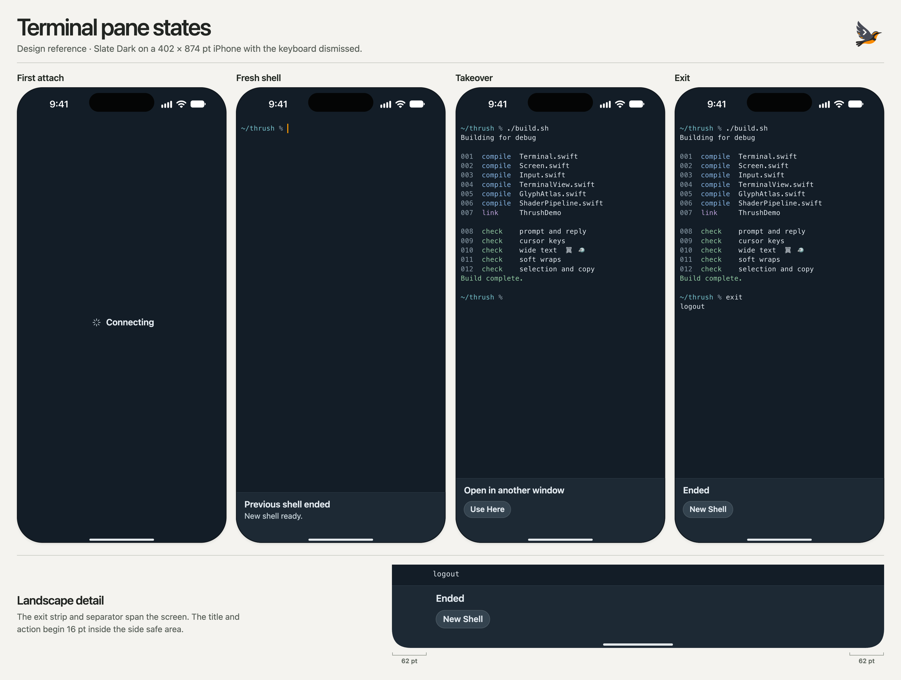
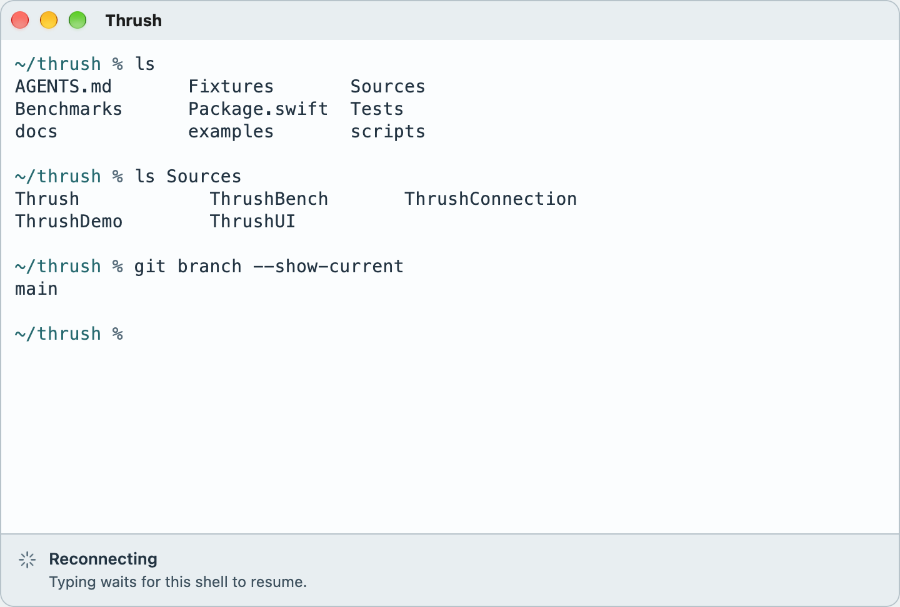

# Terminal pane connection states

`TerminalPane(terminal)` owns these states on Mac and iPhone. Its normal appearance is the terminal alone. **Use Here** is the only action that takes a shell back from another window. **New Shell** starts a fresh shell after exit. Both work with the iPhone keyboard down. The app that embeds the pane supplies its socket factory and can optionally observe exit. Toy Box keeps its viewer open on exit, so the final output and New Shell action remain available.

## Exact copy and input

| When | Visible copy | What happens to input |
| --- | --- | --- |
| Opening a terminal | **Connecting** | Wait for a usable shell before enabling input. A first successful attach goes directly to the grid, whether it created a shell or resumed an existing one. |
| An attached shell loses its socket | **Reconnecting** Typing waits for this shell to resume. | Keep the last displayed transcript. The connection holds committed text, paste and keys in order. The old prompt stays still. Release unsent input once, only after `ready(resumed: true)` and its replay restore the shell and its input modes. |
| A fresh shell unexpectedly replaces the one this connection had | **Previous shell ended** New shell ready. | Clear the old grid, selection, marked text, Ctrl latch and held input. The new shell accepts new input. If input was held, use **New shell ready. Held input was discarded.** as the second line. Base the notice on the server’s fresh ready and the adapter’s replacement flag. |
| Another window takes the shell | **Open in another window** **Use Here** | Show the last frame for reading, selection and copy. Stop automatic reconnect. Only activation of the native button requests ownership. The activation sends zero terminal bytes. Touching output, scrolling, moving focus, foregrounding and typing ordinary characters leave ownership with the other window. |
| The shell exits | **Ended** **New Shell** | Finish applying the last output and present the final frame before displaying Ended or invoking the optional `onExit` for that exit. Keep the transcript readable and copyable. New Shell requests a fresh shell with the same connection configuration and an empty input queue. |

On **Use Here** or **New Shell**, consume the button activation exactly once and retain the transcript through the request. Show **Connecting** there if the request takes longer than 200 ms. Replace the old transcript when the new shell is ready. Choosing New Shell acknowledges the exit. On success, go directly to the new grid. If Use Here resumes a shell, wait for replay. If it discovers that the previous shell ended, show the replacement notice.

Keep the replacement notice until the user commits input in the new shell and has had at least three visible seconds to read it. Scrolling, selecting and copying preserve the notice. Defer removal while VoiceOver is reading it. An ordinary successful resume needs no success message.

## In-band replay

A live socket can send `ready(resumed: true)` to refresh a screen after the reader falls behind. Keep input and the last displayed generation live while the reset and replay build privately. Present the complete replay as one generation, with no status, blank frame or VoiceOver announcement.

- At the live edge, follow the restored cursor. In history, preserve the top logical line and its offset through soft wraps. Match text and neighboring lines across the reset, since row numbers can change. If the line has expired, use its nearest identifiable surviving neighbor, falling back to the oldest retained line.
- Keep an active selection and its handles only when both endpoints and the intervening text identify the same logical range. Reposition the handles for the new cell geometry. If the range is absent or ambiguous, clear the selection and its edit menu. Copy always reads the displayed generation.
- Keep the native marked string, its internal selection and the same input responder. Move the composition to the restored cursor when the frame swaps. Replay sends no composition bytes. The user’s eventual commit goes to the still-active shell exactly once.

## Layout and motion

- **First attach.** Start on the opaque terminal canvas. After 200 ms, center a small native activity indicator and **Connecting** as a group in the usable pane. Cancel the pending reveal on a quick connection or if the pane leaves the window. Apply the same delay to a reconnect. One continuous outage produces one notice across all retry attempts.
- **With a transcript.** Put a native status area at the lower edge of the usable pane, above the accessory, keyboard or bottom safe area. Extend the opaque backing and its single top separator to both physical edges of the pane, including the side safe areas in landscape and the trailing rail on a folded iPhone Duo. Apply the content padding inside the safe area so the heading, detail and button remain readable and tappable. Toy Box supplies the floating title and Close control at the top. Put the action directly below the heading. Keep it visible while the user reads history. The live grid has no permanent status area.
- **Reading.** Keep the live prompt or the selected logical line visible as the area appears. Output scrolls above the status area. The final line, selection handles and edit menu stay reachable. A status is native UI, so copying text or replaying a session never inserts these words into the transcript. Preserve whole cells. A fade, an animation tick or a retry attempt sends no resize. Keyboard or container changes still report each distinct settled grid size.
- **Type and controls.** At the default sizes use 17 pt semibold and 15 pt regular on iPhone, 13 pt semibold and 12 pt regular on Mac. Use platform UI type for statuses and SF Mono for output. On iPhone give the contents 16 pt horizontal and 8 pt vertical padding, and buttons a minimum 44 × 44 pt hit area. On Mac use 12 pt horizontal padding and a regular native button. Let localized text and accessibility sizes wrap before shrinking the type. On a short landscape viewport the status contents can scroll when needed to keep the button reachable.
- **Color.** Slate Dark pairs `#E3EAF0` text and `#1D2934` backing, with a `#35424E` separator. Slate Light pairs `#233442` text and `#E8EEF1` backing, with a `#B7C3CA` separator. Secondary text can use `#8697A4` in Dark and `#586D7B` in Light, for 4.92:1 and 4.61:1 contrast on their backings. Keep status and buttons in the host appearance when a program changes ANSI colors or uses reverse video. The status surface is already opaque under Reduce Transparency.
- **Transitions.** A brief opacity transition of about 120 ms is enough. Choose a stationary indicator and apply the layout directly with Reduce Motion. Suppress the old text cursor while input is unavailable or held. Put the cursor back on the first usable live generation, using the shell’s cursor visibility and shape. Draw the indicator in the native host. An outage does not start a Metal animation loop.

## Focus and review

Keep the keyboard and input focus through a short reconnect if the user was typing. Hold only committed input. IME preedit remains local. Takeover and exit end terminal input, clear composition and the one-shot modifier, and allow the software keyboard to dismiss. When Use Here succeeds with the keyboard down, leave it down. One tap has restored ownership, and touching the live grid then opens the keyboard. A passive reconnect never summons the keyboard or takes focus from another app control.

Expose each status as native text and each action as a native button in focus order. Announce a newly visible state once without moving VoiceOver’s reading position or repeating announcements during backoff. The takeover button’s accessibility label is **Use shell in this window**. Include the visible caption **Use Here** among its Voice Control commands. The exit button’s visible title, accessibility label and Voice Control command are **New Shell**. Its accessibility hint is “Starts a new shell.” A focused button accepts standard keyboard or assistive activation. Status symbols are decorative.

For sign-off, capture all four states on the running iPhone pane in Slate Dark at default text size, with the keyboard down for takeover. Record a reconnect while typing on iPhone and in a Mac window, and exercise the two actions. Verify a short reconnect never flashes, an interrupted Vim session restores its key modes before releasing held input, a replacement discards the held input, and Cmd-C or touch Copy still copies the final line after exit. Review Slate Light, landscape, large type, Reduce Motion, Reduce Transparency and VoiceOver in the running hosts. The figures above are design references. The Toy Box integration uses these same package-owned surfaces.

The 200 ms reveal follows the web terminal’s short-connection behavior. The control and canvas tokens come from the approved Slate design. [Web terminal loading state](https://github.com/lostintangent/toy-box/blob/b9d0eca3c5f4e9036e58327ba633eff52474bb92/src/features/terminal/components/Terminal.tsx) · [Slate design](dark-demo.md) · [Control materials](glass.md)
