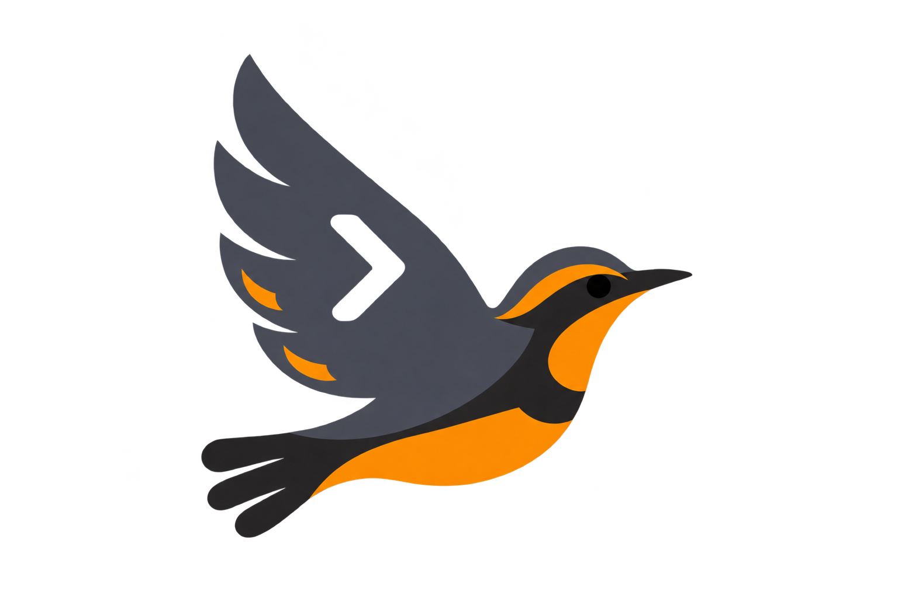

# Thrush



Build a native terminal that any Mac or iPhone app can embed, so someone can run a shell, edit in Vim and use the Codex terminal UI inside it. The app connects a session to its shell through the built-in WebSocket transport or supplies a transport such as a local pseudoterminal (PTY) or SSH. Thrush owns what its output bytes mean, what appears on the screen and how native input becomes bytes again. [Toy Box](https://github.com/lostintangent/toy-box) is the first app to adopt it.

**Quality bar.** Thrush is a 10-star experience that spares no expense on being beautiful on macOS and iOS. Typography, color, motion, input and feel meet the standard of Apple's own best apps, and every visible surface is signed off against the design spec. The performance budgets below are part of that bar, so beauty never costs latency or idle frames.

**Design.** Thrush's default look is **Slate**: SF Mono on a cool slate grid, with the brand amber reserved for the cursor. Slate has a light companion with the same metrics. The view follows the system appearance between the two by default, and apps can supply their own themes (R8). Its palette, metrics, motion and renderer handoff are specified in [Thrush on Mac and iPhone](design/README.md).

**Delivery order.** Build a standalone Swift package against a scripted server. Draw its first visible prompt with Metal. Prove the same demo against a real PTY on Thrush's own server. Toy Box, the first app to adopt Thrush, integrates the proven package into its Mac and iPhone apps last. Thrush ships only as a package embedded in an app. The Mac and iPhone demo apps stay in the repository for development and run on the Mac and the iPhone Simulator. They are never distributed. The first release commits to the three workflows below. Add terminal features when a named workflow or its recorded replay requires them.

## Requirements and acceptance

| ID | Requirement | Evidence to accept it |
| --- | --- | --- |
| R1 | Ship one library product, `Thrush`. Apps import the terminal view, its session and their configuration types through this product. The internal `ThrushCore` target implements the emulator using only the Swift standard library. | An external app target compiles the socket factory, an app-supplied transport factory and the terminal view using the public `Thrush` product. Core tests feed bytes, read the resulting row and check terminal replies headlessly. CI checks the core’s imports and dependency graph. |
| R2 | The core applies every received byte in order, independent of network chunk boundaries and frame rate. It owns terminal column widths, modes, resize behavior and up to 1,000 normal-screen history rows. | The same program output, delivered whole, byte by byte and in recorded chunks, gives identical screen, cursor, modes, history and replies at the same checkpoints. Supported outputs match the independent reference fixtures. |
| R3 | Both platforms use one Metal renderer from the first prompt, with Core Text for glyph shaping and fallback. Interactions use native keyboard, text input, pasteboard and accessibility services. | Packaged Mac and iOS demos compile the package's one embedded shader source at runtime. A captured frame and interaction checks cover styled text, wide text, a selection, the cursor and a single committed composition. VoiceOver can read a known line. |
| R4 | An app supplies a WebSocket factory or a `TerminalTransport` factory that opens a shell at the measured grid size. Thrush ships a PTY server for its WebSocket protocol. An app can also supply a transport for a local PTY or SSH. | The mock and the real server exercise attach, resize, replay, takeover, expiry and final output before exit. A local PTY and a scripted transport check ordered input and replies, resize, hidden output, EOF, close and a new shell in a new session. |
| R5 | Shell, Vim and Codex each work from a real terminal entry point. | **Shell:** type, edit, paste, run a numbered log and copy a soft-wrapped line. **Vim:** open a scratch file, edit, rotate or resize, detach, resume, save and quit to the original prompt. **Codex:** enter a prompt, see its response, navigate the transcript and return to the shell. Verify on Mac and iPhone and retain a deterministic recording for each. |
| R6 | Start the Release benchmark with the first implemented operation. Add parse, resize, presentation, memory and mobile idle metrics as each path becomes available. | Release builds produce reproducible reports for the workloads and budgets below. Device timing comes from a reference Mac and physical iPhone. Shared CI gates deterministic correctness and counts. |
| R7 | Toy Box pins a tested Thrush revision when it adopts the package. | Launch from the approved Mac and iPhone entry points, run the three workflows, verify background/dismissal and reconnect, and compile the embedded shader in both apps. Record the revision and device results. |
| R8 | `Thrush` ships a default light and dark theme and follows the system appearance. An app can supply its own theme, so its users can customize the terminal. A theme sets the default foreground and background, cursor and its ink, selection colors and the 16 ANSI colors. | Mac and iPhone captures show both defaults from one build. Changing the system appearance redraws the next frame in the other theme without reparsing or rasterizing glyphs again, then settles to zero frames. A custom app theme changes every listed color. OSC 4, 10 and 11 color queries reply with the active theme's colors, so programs such as Vim and Codex can choose a matching scheme. |

**Platform baseline.** Set macOS and iOS deployment minimums to 27.0. Use Swift 6 language mode, SwiftPM tools 6.4, and the installed Swift 6.4.2 / Xcode 27.2 toolchain with 27.2 SDKs. One manifest defines the library, tests and the in-repo `ThrushBench` executable. Build and test from the command line. Apple builds for the phone need the device or simulator SDK, bundling and destination-appropriate signing. A checked-in Xcode project is unnecessary. [Apple SDK and Swift matrix](https://developer.apple.com/xcode/system-requirements/) · [Swift Package Manager](https://docs.swift.org/main/documentation/packagemanagerdocs/) · [Toy Box’s CLI phone build](https://github.com/lostintangent/toy-box-apple/blob/e6a434bcf7a768d0fa88f240deba8d223071a7f0/scripts/mobile/bundle/index.ts)

**Embedding.** Thrush has to fit apps that aren't built with Xcode. An app pins an exact Thrush tag and can link the library statically into its target. Its bundler might copy no SwiftPM resource bundles, and its Mac build might use Command Line Tools, which have neither a Metal compiler nor the SwiftUI macro plugin. Toy Box builds this way. The library compiles its shader from embedded source with `makeLibrary(source:)`. Code the Mac compiles uses no `@State` or `@Entry`. UI types are explicitly main-actor isolated, and no code blocks a cooperative thread, so apps can test with `LIBDISPATCH_COOPERATIVE_POOL_STRICT=1`. [Toy Box’s screen socket](https://github.com/lostintangent/toy-box-apple/blob/e6a434bcf7a768d0fa88f240deba8d223071a7f0/Sources/Shared/ToyBoxClient/Transport/ChannelAPI.swift#L230)

**Integration.** Adding Thrush to an app must be as simple as adding a terminal to a web client, or simpler. Toy Box's web client mounts one component, but it keeps about 500 lines of its own to fit, theme, reconnect, hold input and draw a key row for phones. Thrush owns all of that, so an app writes a socket factory and presents one view.

```swift
import Thrush

// Once per tab, in a model that outlives the view.
let session = TerminalSession { size in
    api.terminalSocket(clientID: tabID, size: size)
}

// Wherever the terminal appears.
TerminalView(session)
```

The terminal view measures its grid and reports each new size, follows the system appearance and shows the standard iPhone key row. It handles drawing, input, focus, selection and scrolling through history. On Mac the WebSocket transport keeps its attachment while the view belongs to an open window, including a covered, minimized or hidden window. Drawing stops while nothing is visible. On iPhone the attachment survives an inactive foreground scene, including Control Center, Notification Center, the app switcher and system alerts. The WebSocket detaches when the app hides the view with `isActive: false`, SwiftUI removes or hides its destination, or the iPhone scene enters the background. The server preserves a detached shell for its orphan window, which is 30 seconds in Thrush’s server and Toy Box’s. An app-supplied transport keeps reading the same shell while the view is hidden and the app can run. A lost WebSocket reconnects after 250 ms, doubling to 4 s. A small spinner at the cursor indicates opening or reconnecting after 200 ms. VoiceOver announces a sustained reconnect once and announces when the shell ends. If another window takes the shell, a deliberate tap or keystroke in the terminal requests it back. Held input reaches the same shell only after replay. On replacement, the session keeps its previous main screen in history, accepts input for the fresh shell at row one and announces “New shell” once. On exit or explicit close it sets `hasEnded` and retains its screen. The app decides whether to keep or close the tab and can create a new `TerminalSession` for another shell. Optional arguments set a theme, font size or key row. An app can explicitly end the session with `try await session.close()`. [Session lifecycle and input behavior](design/lifecycle.md) · [Toy Box’s web terminal](https://github.com/lostintangent/toy-box/tree/b9d0eca3c5f4e9036e58327ba633eff52474bb92/src/features/terminal/client)

`TerminalView(session)` paints under a navigation bar, a full-size-content Mac toolbar, the home indicator and the landscape side insets, the way a SwiftUI background does. Where padding or its container keeps the view's frame from a safe-area edge, the view stays inside it. Row one sits inside the native safe area below the bar, and the cursor spinner uses the same grid coordinates as the cursor. On iPhone the keyboard sets the lower edge of the usable grid.

**Metal.** Apps compile the shader at runtime, so a cleanly packaged app on each platform must compile the embedded source, and its cold cost is measured. [Packaging a Metal renderer](https://developer.apple.com/documentation/technotes/tn3133-packaging-a-renderer) · [Xcode components](https://developer.apple.com/documentation/xcode/downloading-and-installing-additional-xcode-components)

## The ontology

An app imports `Thrush`, keeps one observable `TerminalSession` per tab and presents it with `TerminalView`. Both factories receive the measured `Terminal.Size`. A WebSocket factory captures the tab ID and returns a fresh, suspended task on each attachment. An app-supplied transport factory opens a local or remote shell. An app can customize `TerminalTheme` with `Terminal.Palette` and `Terminal.RGB`, and hide the iPhone key row. The session owns the terminal model and drives I/O until the app closes it or the shell ends.

| Type | Responsibility | Operations |
| --- | --- | --- |
| `TerminalSession` | One terminal and the shell it talks to, independent of the view. | The app supplies a factory, observes `title` and `hasEnded` on the main actor, and can call `close()`. An ended session remains available for reading. The app can show a different session in the same view. |
| `TerminalTransport` | The transport an app supplies for its shell. | `read()` returns shell output and `nil` at EOF. `write(_:)` carries input and terminal replies. `resize(to:)` changes the shell’s grid. `close()` releases resources and wakes pending I/O. |
| `TerminalView` | Presents the session in SwiftUI. Keeps its native viewport alive across body updates. | Measures the grid and shows a spinner at the cursor while opening or reconnecting. Leaving a tab detaches its WebSocket or stops observing changes from an app-supplied transport. Covering or minimizing a Mac window pauses drawing. |
| `Terminal` | The emulator. It owns both grids, history, cursor, styles, modes and partial UTF-8 or escape sequences. Apps use its grid dimensions and palette values. | Package targets use `receive` to apply PTY output and collect replies, `encode` to encode input under current modes, `resize(to:)` to reflow and `text(inRow:)` to check visible text. When a replacement shell starts, the session archives the previous main screen. A replay restores the current shell while preserving earlier shells' retained rows. |
| `TerminalMetalView` (package) | Owns a viewport’s scroll position, selection, focus, composition, theme, font and pixel geometry. | Draws visible cells, copies logical text, commits composition and reports semantic input and grid changes to `TerminalView`. |

The package computes effective grid dimensions once for the emulator and socket. A request for one column yields two columns, matching the server. Inside the emulator, `Input` carries committed text, paste, a key with modifiers or a pointer event. `Screen` holds the grid, cursor and wrap boundaries. The normal buffer has bounded history and survives a switch to the alternate screen. A `Cell` stores text and attributes in one column. Its colors are default, indexed or direct RGB, so a theme change leaves the grid intact. Wide characters occupy two cells and combining marks attach to their base. Widths follow the pinned reference's Unicode 11 tables. The streamed UTF-8 decoder consumes a byte-order mark without advancing the cursor. [Reference pin](../Fixtures/reference/conformance/reference.json)

- **Theme changes.** A headless emulator starts with its own default palette. The terminal view supplies the active theme’s palette and cursor color to the session and updates them when the theme changes. OSC 4 queries read an indexed color, OSC 10 reads the foreground, OSC 11 reads the background and OSC 12 reads the cursor. The first 16 indices come from the theme. The remaining indices use the standard 6 × 6 × 6 color cube and grayscale ramp. A program can set any of these colors with the same commands. Its colors layer over the theme until it restores them with OSC 104, 110, 111 or 112, so a theme change or a resume never undoes them. A program that sets mode 2031 hears each switch between a dark and a light theme, judged by the theme's background, and DECDSR 996 asks for the current one. [Appearance reports](emulator.md#principles)
- **Terminal titles.** OSC 0 and OSC 2 set the session’s title when BEL or ST terminates the command. An empty title clears it. OSC 1 sets only an icon name and has no effect on the app’s title. RIS preserves the title. During a resumed attachment the model retains its last title until the replay arrives. The first OSC 2 in the replay supplies the server’s current title, including an explicit empty string. A fresh shell starts with an empty title. SwiftUI can read it directly with `.navigationTitle(session.title)`.
- **Typing.** Native input produces a key or committed text. The session calls `encode` and sends the returned bytes. The shell controls echo. The session answers cursor queries over an app-supplied transport even while its view is hidden. A WebSocket server handles queries while its shell is orphaned.
- **Resizing.** The native view derives whole rows and columns from font metrics, scale and usable bounds. The session applies each changed size to the emulator and forwards it using the transport. Normal history reflows at soft wraps. The alternate buffer follows the reference's clipping and expansion behavior. If the reference exposes fewer defined rows than the requested viewport after an alternate-screen resize, Thrush fills the missing row with blank cells. Erasing that row preserves history.
- **Scrolling and copying.** Program output changes the grid and history. A reader’s scroll gesture changes the viewport. The view asks the core for the relevant rows and wrap information so copy and VoiceOver agree with the displayed text. VoiceOver reads concealed text as the blank it shows, and copy keeps its characters as other terminals do. With mouse reporting enabled, the view maps native pointer coordinates to a cell and the core encodes the event. Scrolling goes to the program instead of history when it reports the mouse or draws the alternate screen. Each row of travel becomes a wheel report, or Up or Down without reporting. On iPhone a one-finger swipe does the same, and a flick coasts and slows like a native list until a touch stops it. VoiceOver’s three-finger scroll sends the program a page and reads its first line once the program redraws.

**Concurrency boundary.** The view reads the session. Inside the session, `SessionActor` orders transport events, input and size changes, updates the terminal and enqueues writes in that order. At a draw request it hands the UI one coherent, read-only generation of visible rows, wrap boundaries and cursor, reusing unchanged rows. Drawing, selection and accessibility refer to the displayed generation. Newer generations can replace pending draws while parsing continues. Codex uses DEC synchronized-output batches that span transport reads. The core keeps parsing and replying. The view holds the latest batch until reset or a one-second timeout. Read the next output bytes as processing capacity becomes available. Check that a burst drains without unbounded queued chunks and that a cursor and its row always come from the same generation. [Session implementation](../Sources/Thrush/Session)

## The two contracts to test

**Emulation.** Use clean, versioned fixtures for a numbered colored build log, a full-screen Vim session, and a Codex interaction. Store the input and output bytes, delivery boundaries, resizes, expected replies and reference screen checkpoints. Give each chunk, resize and echo marker a monotonic offset from the start so the mock can reproduce bursts and the runner can calculate a sustained peak. Record the pinned reference emulator's version, Unicode settings and fixture hash. Generate reference expectations outside Thrush. The reference emulator is a development tool for producing fixtures. The package ships its own parser, both screens, history and input encoder. Test cursor positioning, erase/insert/delete, scrolling, colors, alternate-screen transitions, bracketed paste, mode-dependent keys and the queries present in the recordings. Bound partial parser state for long or unknown controls. Test recovery after a terminator and across split UTF-8. [Reference fixtures](../Fixtures/reference/README.md) · [Conformance against the reference](../Fixtures/reference/conformance/README.md)

The shell replay checks Bash Readline editing in the middle of a command. Starting from `abcdef`, three Ctrl-B presses followed by Ctrl-D produce `abcef`. Typing `X` from the same cursor produces `abcXdef`. Capture Bash’s insert-character (ICH) and delete-character (DCH) output from a PTY. At 16 columns, a literal horizontal tab after `name` places `value` in column 9. After `progress...`, a carriage return and whole-line erase (EL 2) leave only `Done` when the shell writes it. The pinned reference supplies the expected cells and cursor at each checkpoint. [Shell replay reference](../Fixtures/reference/m2/README.md)

**WebSocket transport.** Use the platform WebSocket client against a scripted peer from day one. The Mac demo and the iPhone Simulator use loopback. The sample apps are never distributed, so a physical iPhone runs Thrush inside an app that embeds Thrush, beginning with Toy Box’s TestFlight build. Record transport time separately from receipt-to-presentation. Connect to `/socket?service=terminal&clientId=…&cols=…&rows=…`. Binary frames carry raw stdin/stdout. JSON carries `ready` with its `resumed` flag, `resize`, explicit `close`, and `exit`. Exercise these transitions before any app adopts the WebSocket transport. [Thrush terminal protocol, lifecycle and replay limits](protocol.md)

| When | Required behavior |
| --- | --- |
| Fresh attach or orphan expiry | A first `ready(resumed: false)` starts a clean grid. If a session trying to resume its shell receives fresh ready, it discards held input, moves the old main screen into history and adopts the new shell with a clean screen and fresh modes. `hasEnded` stays false. |
| Brief detach and resume | The WebSocket transport reuses the tab’s client ID. The `ready(resumed: true)` control puts the session in `.awaitingReplay`. Apply the next binary message to a clean terminal, publish one `.replay` event, then apply live bytes in socket order. The server preserves both grids, their visible contents, cursor and modes. The [protocol](protocol.md#replay) describes how a narrowed grid limits the replay. Both recorded Vim grids must match the uninterrupted screen cell for cell, including colors and cursor position. Saving and quitting restores the default-colored shell prompt. The recorded serializer is identified by its [source digest](../Fixtures/reference/m4/README.md#vim-reattachment). |
| In-band replay | When pending writes drain, the server sends `ready(resumed: true)` and a replay on the same WebSocket. The session keeps accepting input. The view displays the current screen until the complete replay is ready. Preserve surviving history and selection anchors and local composition as specified in the [session lifecycle](design/lifecycle.md#in-band-replay). |
| Takeover | A second socket using that ID takes ownership. Close code 4000 parks the displaced client. Tapping the terminal or typing there requests the same shell back. Hold a triggering keystroke through the handshake and send it once after replay. Focus, foreground return and scrolling leave ownership with the other window. Discard callbacks from the displaced socket. |
| Dismiss, background, close or exit | Dismissal, a tab hidden by the app or an iPhone scene entering the background detaches the socket. Mac app activation and window occlusion never do. The server preserves an orphan for 30 seconds. Explicit close ends the PTY. Shell exit displays final bytes before reporting exit. |

The demo supplies a server URL. An app can supply a factory that returns a fresh, suspended `URLSessionWebSocketTask` for the stable client ID and effective size on each attachment. The app owns its `URLSession` and its authentication and TLS settings. The built-in `WebSocketTransport` resumes and releases each task. Keep one `TerminalSession` per tab through background and foreground. On a resumed attachment, keep the previous screen visible until the replay restores the terminal. Then send held input using the restored modes. A size change during the handshake takes effect after replay at the dimensions used in the attach URL. The [WebSocket lifecycle benchmark](../Benchmarks/transport.md#websocket-transport) measures the same lifecycle exchange over loopback.

For an in-band replay, the session keeps its current input modes while waiting for the binary message. It applies the replay to a clean terminal at the negotiated size, then applies the latest requested size and emits one `.replay` event. The view replaces its drawing cache and screen together. Subsequent live bytes stay in socket order. Exit ends the session before the server's normal WebSocket close.

While the terminal view is active, an ordinary WebSocket failure retries after 250 ms, doubling to a maximum of 4 s. Ready resets the delay. Recovery holds at most 256 typed inputs and 64 KiB of UTF-8, charging character keys their source bytes and other keys one byte. Pointer events refer to the old grid and are dropped during recovery. An input that exceeds either limit is rejected as a whole. A resumed shell receives those inputs in order after replay restores its modes. Displacement, background detach, explicit close or fresh ready while resuming discards the held inputs. A keystroke that requests a displaced shell back starts a new queue for that attempt. A write with uncertain delivery is never sent again. The demo can timestamp an input when its WebSocket write actually starts, including an input released after replay.

A session that adopts a replacement shell sends new input immediately. Its previous main screen remains in history across a later replay of the new shell. Natural exit and explicit close end the session permanently. Closing with no live socket cancels retries, ends the session locally and reports the missing transport. The server's orphan deadline then releases the remote PTY.

**App-supplied transports.** With `TerminalSession(openTransport:)`, the app opens a shell at the view’s first measured grid size. The session’s internal `AppTransport` reads shell output, writes encoded input and terminal replies in order, and forwards later grid sizes. While the view is visible, a private `Subscription` delivers screen changes. Hiding the view ends its subscription. The session continues to apply output while the app can run. When the view subscribes again, it receives the retained `.screen` and applies its measured size. The same transport remains open throughout.

After the shell’s last output, `read()` returns `nil`. EOF or a transport error ends the session with its final screen intact. A new `TerminalSession` calls the factory to open another shell at the measured grid. Explicit close wakes pending I/O, releases the transport and permanently ends the session. The [app transport benchmark](../Benchmarks/transport.md#app-transport) checks the recorded rows and terminal replies independently of timing.

## Performance from the first commit

One command, `swift run -c release ThrushBench`, prints a results table and emits machine-readable JSON. Time a prompt and query as soon as those work. Each new operation brings its benchmark and correctness checkpoint in the same change. The headless runner feeds fixtures directly. The demo plays the same bytes through the mock socket. Start with a fixed 80 × 24 grid, also record phone portrait and landscape sizes, and include the exact grid in each report.

| Exercise | Measurement | Initial target on each reference device |
| --- | --- | --- |
| Parse and apply | Measure MiB/s, per-chunk time, bytes received/applied, maximum queued bytes and time to drain. Calculate the fixture’s peak sustained input over a recorded one-second window. | Match all checkpoints and reply bytes. Sustain at least **2×** the fixture’s peak rate headlessly. At recorded playback speed on screen, apply every received byte and drain the queue after a burst. |
| Resize | Fill 1,000 history rows, run a fixed wide → narrow → wide sequence, then repeat on the alternate screen. Measure p50/p95 and compare cursor, text, wide cells and wraps to the reference after each change. | **p95 within one measured display interval** at full history. |
| Draw and type | Measure cold glyph uploads, warm scrolling, cursor-only, one-row and full redraws. Record CPU preparation, GPU duration, key-to-send, receipt-to-presentation and key-to-visible-echo. Verify the marked echo in a captured frame. | Under recorded load, **p95 receipt-to-visible-echo within two display intervals**. Report key-to-echo separately because it includes the peer. Track presentation misses at the actual refresh rate. |
| Idle, memory and energy | Count frames at a settled prompt, while text blinks and with Reduce Motion, then background the app. Repeat a warmed log with a fixed glyph set ten times. On the physical phone, profile foreground idle and sustained playback with the same brightness, power mode and thermal state. | **Zero additional idle or background frames** after work settles. Blinking text draws only during its fades, and never with Reduce Motion. History and atlas remain bounded. Record memory in MiB across passes and require a plateau. Use the first phone profile to set a numerical memory ceiling and energy baseline. |

Use one shared Metal renderer, one shader source per function compiled for both SDKs, Core Text shaping/fallback and a bounded glyph atlas including color emoji. The session reads ordinary output independently of the view. Program output draws once its writes pause for 1 ms, and at most once per display refresh by a deadline from the measured frame cost, so the pieces of one change share a frame and echo waits 1 ms longer than an immediate draw on any display. Further output can replace the pending snapshot until Metal encodes the grid. The receipt time belongs to the first update that frame includes. The session delivers transitions into and out of synchronized output, replay, shell replacement and exit in order. Invalidate for content, viewport, selection or cursor changes. Reuse unchanged geometry and draw a complete visible frame into each new drawable. Handle display-scale changes, memory pressure and foreground return. Verify glyph alignment and shader loading on both platforms. [How output reaches a frame](rendering.md) · [Core Text](https://developer.apple.com/documentation/coretext/) · [MetalKit drawing modes](https://developer.apple.com/documentation/metalkit/mtkview/enablesetneedsdisplay)

Use a monotonic host clock and each drawable’s actual `presentedTime` to correlate marked bytes with their first visible frame. Record unpresented frames separately. Compare candidate and main in Release on the same quiet machine. Save commit, fixture hash, hardware, OS, grid, display interval, thermal and power state with each run. ThrushBench also records the core count and the one-, five- and fifteen-minute load averages. It labels a run contended when the one-minute load exceeds the active core count. Capture at least five quiet runs for a reference baseline. Establish run-to-run noise before enforcing timing regressions. CI asserts deterministic output, counts and bounds. The simulator covers behavior and packaging. Use a physical iPhone for timing, memory pressure and power. On it and an unlocked Mac, use `presentedTime` to measure where the compositor takes a frame against the display link's target. If the target holds, let output that begins early in a refresh wait until just before its deadline, so bursts the network spreads wider than 1 ms still share a frame. These timing numbers are proposed acceptance budgets. The Lead records measured baselines and any revised budget with its rationale. [Metal presentation timestamps](https://developer.apple.com/documentation/metal/mtldrawable/presentedtime) · [Apple Metal profiling tools](https://developer.apple.com/metal/tools/)

### Keeping the core fast and simple

ThrushCore runs faster than @xterm/headless on every [comparison](../Benchmarks/comparison.md) workload and matches or beats libghostty-vt on everyday ones. [Where Thrush loses time](../Benchmarks/comparison.md#where-thrush-loses-time) traces each remaining gap to its costs. A gap gets closed for a gain someone would notice, not a marginal one. Clarity comes first. A change that makes the core simpler may cost up to 2% on any workload, and a technique worth more than 2% somewhere stays, behind one name. Run the comparison, ThrushBench and the conformance harness before and after each change to the core, and refresh the comparison when one lands.

Each technique lives in the file that owns it, so the rest of the core keeps calling plain operations. `Cell.swift` owns row storage, the cell layout, the style list and bulk writes. `TextScanner.swift` owns SIMD scanning and decoding. `EscapeParser+Transitions.swift` owns the transition table.

## Build sequence

The Lead assigns one owner per deliverable and reviews its evidence. Each milestone builds on the preceding one. The real-server smoke test can start as soon as the Mac prompt works. Integration into the first app waits for the standalone checks on both platforms.

| Milestone | Accountable owner | Work and exit condition |
| --- | --- | --- |
| **1 · First bytes** | Core | In the standalone workspace, define the manifest, first-party target boundaries, Release runner and a scripted loopback peer. Implement just enough `receive` and `encode` for a prompt, mode-dependent arrow key and cursor-position query. Core tests read the prompt and verify the reply, the mock checks the exact outbound byte order, and the runner saves its first baseline. |
| **2 · Headless emulator** | Core | Implement the modes used by the shell and editor recordings, both screens, bounded history, width rules and `resize`. Pass the split-input, unrecognized-control, wide-text, alternate-screen and resize checkpoints. Save throughput, queue and resize measurements. The Lead reviews R1–R2 and the headless portion of R6. |
| **3 · First Metal prompt** | Renderer | Mount the shared renderer in thin Mac and iPhone apps. From clean CLI-built bundles, show the mock prompt and a styled editor frame on both platforms in the light and dark themes, switching live with the system appearance. Record the same Swift file in Vim against each Slate palette, with syntax, line numbers and a status line. Vim selects its background from the OSC 11 reply. Inspect glyph placement, cursor, dirty-row updates and generation consistency. Capture cold/warm rendering, presentation timestamps and idle frame counts. |
| **4 · Standalone interactions** | Demo | Use the same WebSocket transport to drive typing, paste, composition, hardware keys, Escape/Control/Tab/arrows, pointer input, selection, copy, VoiceOver, keyboard avoidance and rotation. During keyboard-open rotation, keep the live prompt or reading position anchored and send one settled grid size per turn. Add the Codex recording. Prove R3 and run recorded counterparts of the three R5 workflows plus every R4 lifecycle branch against the mock. Milestone 5 owns live workflow acceptance. The physical-iPhone pass happens in milestone 6, on Toy Box's TestFlight build. |
| **5 · Real PTY** | Connection | Change only the demo endpoint to Thrush's PTY server. Run the three R5 workflows on Mac and iPhone, including foreground return, takeover, orphan expiry and exit. Send a deterministic numbered log and compare expected markers, received bytes and applied bytes to locate any loss. The server skips live writes when the next write would exceed 1 MiB of outstanding output or 256 messages are already pending. Report observed loss and rate with the end-to-end timings before accepting R4–R6. |
| **6 · First app: Toy Box** | Toy Box (iOS/macOS) lead | The iPhone app comes first and the Mac follows. The Toy Box lead records the approved entry points in the Apple product spec. Their Core pins the tested Thrush tag, adds the terminal socket to ToyBoxClient and supplies its factory to `TerminalSession`. Their Overview and Shell owners present `TerminalView` at the entry. Thrush's members stay on call through the Lead. Verify R7, repeat R5 from the app's entry point and compare timing to the standalone baseline. Toy Box ships it through its existing TestFlight pipeline. The user runs the physical-iPhone pass on that build, returns the R6 profile and approves release. |

Toy Box's server send path, Apple product spec and existing socket construction anchor its integration. [Server send path](https://github.com/lostintangent/toy-box/blob/b9d0eca3c5f4e9036e58327ba633eff52474bb92/src/features/terminal/server/runtime.ts) · [Apple client product spec](https://github.com/lostintangent/toy-box-apple/blob/e6a434bcf7a768d0fa88f240deba8d223071a7f0/docs/spec.md) · [Existing socket construction](https://github.com/lostintangent/toy-box-apple/blob/e6a434bcf7a768d0fa88f240deba8d223071a7f0/Sources/Shared/ToyBoxClient/Transport/ChannelAPI.swift)
